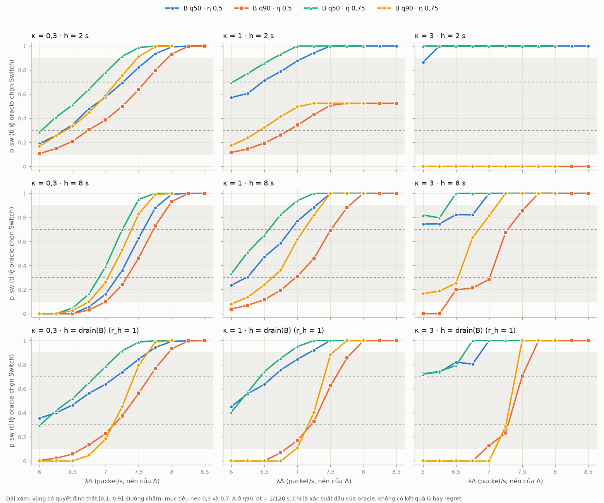

# Thử nghiệm REFORMULATE lưới — báo cáo

> **Provenance.** Claude (AI) chạy và viết theo yêu cầu của **Doan Van Tai**, 23/10/2026, trên nhánh `explore/reformulate-grid`. Đây là **DISCOVERY**, chưa được tác giả xác nhận, không thay đổi `main`, không tag. Kế hoạch: [reformulate_grid_plan.md](reformulate_grid_plan.md) (commit `db955de`, trước mọi phép tính).
>
> **Chỉ tính đại lượng thiết kế:** chứng chỉ prior, D, khoảng $p_{\text{sw}}$, nhãn ĐK1, budget. **Không tính** $J$, $L_*$, margin, belief, $M_0/M_1$, contrast hay regret. Không đụng các tọa độ để dành làm held-out.

## 1. Kết luận

Lưới v1.1 hỏng vì đặt $\lambda_A$ chung cho mọi ô, trong khi vùng "có quyết định thật" nằm ở chỗ khác nhau cho từng tổ hợp ($\kappa$, $y_B$, $\eta$, horizon).

Thủ tục tốt nhất là **P4**: với mỗi tổ hợp, dò $\lambda_A$ trên một thang cố định cho tới khi $p_{\text{sw}}$ gần 0,3 và gần 0,7, và dùng **horizon vật lý cố định** thay cho $h=T_{\text{drain}}(B)$.

Với horizon 8 s, 22/24 mục tiêu lõi neo được. Mọi ô neo được:
- vẫn nằm trong $[0{,}1;0{,}9]$ ở dt, dt/2 **và dt/4** (trôi tối đa 0,003);
- đều có nhãn ĐK1 `candidate`;
- đều nằm trong budget A01 tới dt/16 (tối đa $6{,}8\times10^{10}$ so với trần $2\times10^{11}$).

## 2. So sánh năm thủ tục

| Thủ tục | Ô chính đạt | Vượt budget dt/16 | Độ phủ trục trong tập đạt |
|---|---|---|---|
| P0 — lưới v1.1 sau redesign (dữ liệu cũ) | 11/22 (50%) | 6 | $\eta$ 1 mức, $\psi$ 2 mức gần nhau ($-0{,}10$; $-0{,}08$) |
| P1 — đối xứng ($\lambda_A=\lambda_B-u$), $r_h=1$ | 10/16 (63%) | 4 | không có trục tải; $\psi$ do $\eta$ quyết định |
| P2 — đối xứng, $h\in\{2;8\}$ s | 19/32 (59%) | 0 | như P1 |
| P3 — neo, $r_h=1$ | neo 26/32 (81%) | 7 | đủ trục; $\psi\in[-0{,}20;0{,}00]$ |
| **P4 — neo, $h\in\{2;8\}$ s** | **neo 48/64 (75%)**; 30/32 ở $h=8$ | **0** | đủ trục; $\psi\in[-0{,}20;+0{,}05]$, 11 mức |

Theo luật viết trước (§7 của kế hoạch), chỉ P4 có mọi ô chính vừa trong dải vừa trong budget. Số liệu: `results/explore_reformulate/summary.json`.



*Hình: $p_{\text{sw}}$ theo $\lambda_A$, A ở q90, dt = 1/120. Dải xám là $[0{,}1;0{,}9]$. Ở panel κ = 3, h = 2 s, các đường trùng nhau tại 1 và tại 0.*

## 3. Bốn điều thử nghiệm cho thấy

1. **Ranh giới dịch theo $y_B$ và $\kappa$.** Ví dụ ở $h=8$, $\eta=0{,}5$: điểm $p_{\text{sw}}=0{,}5$ nằm ở $\lambda_A\approx7{,}38$ (B q50, κ 0,3), $\approx7{,}54$ (B q90, κ 0,3) và $\approx6{,}56$ (B q50, κ 1) — nội suy tuyến tính giữa hai điểm thang (`anchors.csv`). Một mức $\lambda_A$ chung không thể đặt mọi ô vào dải. Đây là nguyên nhân gốc của B4 thất bại.
2. **Horizon ngắn hoặc mode kéo dài tạo vùng bị khóa bởi cấu trúc.** Kiểm ĐK1 bổ sung ở năm ô — ngoài kế hoạch, chạy sau khi thấy giai đoạn 1 (`probe_labels.py`, `probe_labels.jsonl`):
   - κ 3, B q90, h 2 s: **conservation-cell**, hai action có cost bằng nhau tuyệt đối;
   - κ 3, B q50, η 0,75, h 2 s: **WD-cell**;
   - κ 1, B q90, h 2 s, λA 8: **WD-cell**, dù $p_{\text{sw}}=0{,}52$ nằm trong dải — phần còn lại là hòa.

   Vì vậy **$p_{\text{sw}}$ trong dải chưa đủ; phải kèm nhãn ĐK1 `candidate`**. Những vùng này không phải lỗi. Chúng cho RQ1 biết chỗ thông tin state không thể đổi quyết định.
3. **Horizon vật lý ổn định và rẻ.** $h=T_{\text{drain}}(B)$ làm horizon phình tới 97 s khi B có backlog lớn (κ 3, q90), khiến 4–7 ô vượt budget. $h=8$ s giữ mọi ô trong budget, và tách horizon khỏi backlog B. $r_h=h/T_{\text{drain}}(B)$ vẫn được tính và báo như tọa độ giải thích, đúng gợi ý của Final Review §5.3.
4. **Nội suy không đủ tin để đặt held-out.** Dự đoán điểm neo ở κ 1 từ κ 0,3 và 3 chỉ làm được khi cả hai đầu có ranh giới: 4/4 rơi vào dải ở h = 8, nhưng ở B q50 thì κ 3 không có điểm cắt 0,3. Đường $p_{\text{sw}}$ cũng không đơn điệu ở 8/48 lát (backlog quan sát nhảy theo lattice khi $\lambda_A$ đổi). Vì vậy held-out nên được neo bằng cùng luật dò, không bằng nội suy.

## 4. Lưới đề xuất v1.2 (bản nháp để tác giả quyết)

Danh sách đầy đủ, kèm $\lambda_A$, $\psi$, $p_{\text{sw}}$ ở ba mức dt, nhãn và budget: `results/explore_reformulate/proposed_v1_2_cells.csv`.

| Phần | Cấu trúc | Số ô | Ghi chú |
|---|---|---:|---|
| Lõi | $\kappa\{0{,}3;1;3\}\times y_B\{q50;q90\}\times\eta\{0{,}5;0{,}75\}\times$ mục tiêu$\{0{,}3;0{,}7\}$; $h=8$ s; A q90 | 22 | Ở κ 3, B q50 không có điểm 0,3: mỗi lát chỉ còn một ô ($p\approx0{,}75$–$0{,}80$) |
| Nan hoa trạng thái A | A q50 ở κ 1, $h=8$: $y_B\times\eta\times$ mục tiêu | 8 | Trục "current queue state" của A |
| Nan hoa horizon | $h=2$ s ở κ 0,3: $y_B\times\eta\times$ mục tiêu | 8 | Ở κ ≥ 1, h = 2 bị khóa (mục 3.2) |
| Đầu dò cấu trúc | κ 3, h 2 (conservation); κ 1, B q90, h 2 (WD) | 2 | Không tính vào luật chấp nhận; chỉ báo cáo |
| Kiểm âm | N01–N04, W01, S01 của v1.1 (đã có chứng chỉ) | 6 | Giữ nguyên |
| Held-out | Tọa độ được bảo vệ (ví dụ κ 0,6 và 2; h 4 và 12; η 0,625; B q75), neo bằng cùng luật lúc chốt lưới | ~10–12 | Chưa tính gì ở đây |

**Luật neo** (giữ nguyên luật đã thử):
- thang $\lambda_A$ bước 0,25 từ 6 tới $(\lambda_A+u)/\mu\le0{,}95$;
- chọn điểm có $p_{\text{sw}}$ gần mục tiêu nhất, hòa thì chọn $\lambda_A$ nhỏ hơn;
- ô đạt nếu $p_{\text{sw}}\in[t-0{,}15;t+0{,}15]$ ở dt và dt/2, vẫn trong dải ở dt/4, và nhãn ĐK1 là `candidate`;
- lát không neo được thì giữ lại làm ô ngoài và báo cáo. Không thử lại.

**Giữ nguyên:** ĐK8 (thước đo, ngưỡng, $C_{\text{ref}}$, luật hòa, B2, R2), plant A ON/OFF, D dừng có điều kiện, một observation mỗi ô, solver và engine.

**Thay đổi so với nháp v1.1:**
1. $\psi$ thành đại lượng dẫn xuất; bỏ yêu cầu "$\psi$ hai phía của 0".
2. Horizon là số giây cố định; $r_h$ chỉ còn là tọa độ báo cáo.
3. Luật "≥ 15/22 và một lượt redesign" được thay bằng luật neo có điểm dừng.
4. Held-out được neo bằng screen; bỏ luật "không tính $p_{\text{sw}}$ trên reserve". Phải cấm dùng $p_{\text{sw}}$ riêng của held-out làm biến đầu vào cho $H_0/H_1$ trừ khi biến đó có cho mọi ô.

## 5. Exposure và giới hạn

- Đã xem: $p_{\text{sw}}$ của 480 cặp (lát, $\lambda_A$) ở dt và dt/2, của 48 ô ở dt/4, và nhãn ĐK1 của 53 ô. Tất cả chỉ là xác suất dấu của oracle. Chưa ai xem contrast của bất kỳ ô nào.
- Việc chọn $h=8$ s làm lõi và đưa $h=2$ s xuống nan hoa được quyết **sau khi** thấy $p_{\text{sw}}$. Đây là lựa chọn thiết kế hậu nghiệm, phải ghi DL khi đưa vào `main`.
- Các ô được chọn vì có quyết định thật. Chúng không đại diện tần suất trong mạng thật, và kết quả Phase 3 phải được đọc là có điều kiện.
- $p_{\text{sw}}$ trong dải giới hạn được giá trị state, nhưng không bảo đảm gain vượt $\varepsilon_R$. Gain nhỏ ở Phase 3 vẫn là một kết quả hợp lệ, không phải lỗi thiết kế.
- Thông điệp của commit `cde9944` ghi "before stage-1 results" là không chính xác: lúc đó đã có 5/480 dòng (chưa xem). Đã ghi lại trong §8 của kế hoạch.

## 6. Để đưa vào `main` — cần tác giả quyết

1. Tác giả chọn: dùng P4 không; mục tiêu 0,3/0,7; horizon 8 s và nan hoa 2 s; cỡ lưới (38 ô hay rút gọn); tọa độ held-out. Mỗi lựa chọn viết lý do bằng lời của tác giả.
2. Một DL (REFORMULATE hệ tọa độ lưới, kèm exposure của nhánh này) và một protocol v1.2 commit **trước** lần chạy chính thức.
3. Chạy chính thức trên `main`: tái lập các điểm neo (tất định, phải khớp file này), neo held-out, chọn calibration A01, sáu kiểm nhất quán.
4. Gửi memo cho GVHD trước khi khóa. Tag chỉ khi tác giả quyết.

Tái lập trên nhánh này:

```bash
PYTHONPATH=src:. python -m experiments.explore.reformulate_grid --workers 8   # giai đoạn 1
PYTHONPATH=src:. python -m experiments.explore.analyze_reformulate
PYTHONPATH=src:. python -m experiments.explore.confirm_reformulate --procedure P4
PYTHONPATH=src:. python -m experiments.explore.plot_reformulate
```
