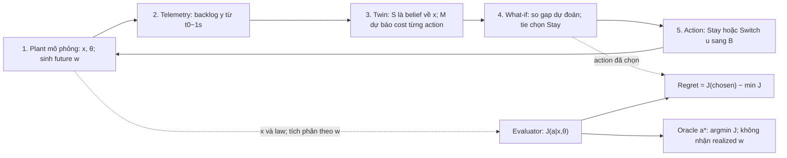

# L2.4 Part 2–3 — bản đồ NDT và vị trí của đề tài

Người phụ trách: **Doan Van Tai** · **25/10/2026**. AI thực hiện hai part tác giả gửi.
Nguồn/đối chiếu là **AI-only**; không ghi tác giả đã đọc hoặc tự trả lời.
[Thẻ tìm kiếm](../../results/lessons/l2_4/search_card.md) ·
[nguồn và mức đọc](../../results/lessons/l2_4/source_access.json) ·
[kết quả kiểm](../../results/lessons/l2_4/verification.json).

## Đọc nhanh

Đề tài tách **thông tin dùng để khởi tạo dự báo** và **cách model dự báo phản ứng
khi chuyển tải**, rồi chấm quyết định trên cùng expected cost. NDT cung cấp bối
cảnh cho sự kết nối dữ liệu–model–action; nhãn NDT không tự chứng minh đóng góp.

[NDT1 §II/Fig.2](papers/NDT1.md) mô tả twin ghép với optimizer.
[NMRG-13 §4/Fig.1](https://datatracker.ietf.org/doc/html/draft-irtf-nmrg-network-digital-twin-arch-13#section-4)
liệt kê **Data, Models, Mapping, Interfaces, Logic**. Bản này vẫn là Internet-Draft,
không phải RFC; chính draft nói chưa có định nghĩa NDT thống nhất và cho phép
use case không cần real-time telemetry. ML là trọng tâm của NDT1, không là yêu
cầu bắt buộc cho mọi NDT.

## Pipeline năm hộp và tầng đánh giá

Evaluator/oracle là vai trò benchmark. Không có mũi tên realized future từ
evaluator sang controller/oracle. M1 dùng đúng law để lấy kỳ vọng, không nhìn
trước realization. Ở **S1M1**, cost dự đoán có thể trùng true J theo contract.

| Biến | Đúng nghĩa contract v1.2 | Đơn vị / quyền thông tin |
|---|---|---|
| x | (qA,qB,mA,mB) tại t0 | packet/mode; S1 và oracle biết |
| y | Snapshot backlog tại t0−1s, không nhiễu, không mode | packet; S0 nhận y/timestamp |
| age | Tuổi snapshot tại thời điểm quyết định | 1s; không đồng nghĩa chu kỳ lấy mẫu |
| S | S0: posterior B2 trên backlog/mode; S1: point mass tại x thật | Distribution; cùng belief giữa M0/M1 |
| θ | Đúng law ON/OFF ở cả hai model | Tốc độ, xác suất/law; không được sửa tham số trong D21 |
| M | M0: trung bình cost mean-rollout từng state; M1: trung bình cost đúng law | Output packet·s; không thay bằng rollout từ mean-state |
| a,u | Stay giữ u trên A; Switch chuyển u sang B ngay t0, giữ suốt h | u=2η packet/s; core u=1 hoặc1,5 |
| w | Background realization sau t0 | Giữ riêng trong plant/evaluator; controller/oracle không nhận |
| C,J | C=dt Σ từ k1 tới H của tổng backlog; J=Ew[C|x,θ] | packet·s; không hindsight |
| h | Core8s, nan hoa2s, held-out4/8/12s | Không gán8s cho mọi ô |

Nguồn vận hành: [contract D2–D21](../01_definitions_v1_2.md). Một quyết định,
action có hiệu lực ngay, tie Stay, không triển khai SDN thật trong pre-spike này.

## Data / Mapping / Models / Logic

| Yếu tố | Can thiệp trong repo | Giới hạn |
|---|---|---|
| Data/Mapping | D20 S0→S1: snapshot cũ/không mode → current backlog/cả hai mode | Không gọi đây chỉ là refresh backlog |
| Models | D21 M0→M1: thay biểu diễn randomness khi θ đúng | Không tương đương retrain hay sửa inferred configuration |
| Logic | Argmin và tie rule giữ nguyên | Không nghiên cứu trust gate mới |
| Interfaces | Các quyền thông tin được lý tưởng hóa | Chưa chứng minh overhead/feasibility vận hành |

“State” trong NDT1 case study là topology/traffic matrix/routing; D7 của repo là
backlog/mode hiện tại. Không suy từ tên biến rằng hai nguồn có cùng estimand
hay timescale. Có thể dùng công cụ simulator làm thành phần NDT khi ghép với
mapping phù hợp; tên phần mềm không tự quyết định hệ là twin hay plant.

## Năm cách chấm twin

| Metric | Đo điều gì? | Nguồn / mức đã kiểm | Khác D18 thế nào? |
|---|---|---|---|
| KPI error | Độ lệch con số dự báo | NDT1 Fig.3 T; S07 abstract A | Không trực tiếp cân lỗi theo tổn thất quyết định |
| So baseline | Delay cải thiện so shortest path | NDT1 Fig.4 T | Chưa là khoảng cách tới oracle D15 |
| Verdict precision/recall | Phân loại conflict/safety | P05 §VI T qua text | Không cân mỗi lỗi bằng cost gap |
| So perfect foresight | Năng lượng giữ được so oracle thấy outcome action | P10 §VIII-E T | Đối chứng khác oracle không biết w |
| Expected decision regret | J(chosen)−min J, cùng x/law | Contract D14–D18 | Chưa có output Phase3; không tự là metric mới |

S07 [abstract v3](https://arxiv.org/abs/2212.12070v3) báo MRE delay6,24% trên1.000 mẫu;
đây là số paper báo, không phải repo tái lập. Không đổi số đó thành MAPE hay regret.
Một nhóm nhỏ nguồn được chọn có chủ đích chưa đại diện cách cả cộng đồng chấm NDT.

## Bảng bản đồ nguồn — chỉ kết luận trong phạm vi đã đọc

| Nguồn | Input / quyết định | Metric | State/model được phân biệt? | PC / vị trí evidence |
|---|---|---|---|---|
| NDT1 | Traffic/topology/routing; optimizer đổi link weights | KPI error, delay so shortest path | Không có D20/D21 được xác nhận trong case study đã đọc | PC2/PC5 bối cảnh; [note](papers/NDT1.md), §II/IV, PDF2–5, T |
| NMRG-13 | Kiến trúc tùy use case | Không là experiment so repair | Năm yếu tố, có Data/Models riêng; không phải2×2 | PC2/PC6 từ vựng; §4/Fig.1, T |
| P05 | State/flow/routing; áp action rồi feedback conflict | Precision/recall | Model bottleneck có demand ngẫu nhiên; chưa xác nhận factorization D20/D21 | PC2/PC5; [note](papers/P05.md), §III/V/VI, T qua text |
| P10 | KPM stream, candidate xApp; gate trước action | Fidelity, false approval, energy | Calibrate và resync khác khối, nhưng resync cũng sửa config/model | PC2/PC5; [note](papers/P10.md), §III/V–VII/VIII-E, T |
| P08 | Optical topology/RSA/power/device info; operational guidance | DT-index/Field-index là đánh giá định tính | Tách parameter identification, device modeling, status update | PC2/PC5; [arXiv v1 §2–3/Fig.2–3, PDF3–5](https://arxiv.org/abs/2312.03374v1), T |
| S07 | Traffic/topology/routing/scheduling; dự báo KPI | MRE delay; jitter/loss trong abstract | Chưa xác nhận can thiệp state/model hoặc lựa chọn action | PC5 bối cảnh; abstract v3, A |

P08 xác nhận **taxonomy đã có**; không xác nhận một valuation2×2 tương ứng D19.
Nội dung field trial P08 chưa được đọc đủ để mô tả hoặc so metric thực địa.
“Không thấy trong các mục đã đọc” không được viết thành “paper không làm” hay “chưa ai làm”.

## Những câu trong tài liệu cần sửa hoặc thêm điều kiện

1. **“State repair chỉ có nghĩa với transient model.”** Quá rộng. Nếu cả model
   lẫn policy thật sự bỏ qua backlog mới, và backlog không sửa belief về input
   khác, refresh riêng backlog không đổi action. Model steady-state vẫn có thể
   hưởng lợi từ thông tin mới về demand, routing hoặc configuration. Không suy
   giá trị D20 bằng0 vì D20 còn cho biết mode.
2. **“Twin không bao giờ biết true J.”** Benchmark có S1M1 dùng đúng x/law nên
   có thể tính đúng J. Phải phân biệt role evaluator với khả năng model lý tưởng
   trả đúng kỳ vọng; không cần nhận realized w để tính kỳ vọng.
3. **“State trong NDT1 thay đổi phút/giờ.”** Không được case study xác nhận như
   quy luật chung. Chỉ ghi input/output và phạm vi thí nghiệm thực có.
4. **Age = mapping pace.** Data age tại t0 khác sampling interval, communication
   delay và actuation delay; contract chỉ khóa tuổi1s và actuation ngay.
5. **OpenTwin resync = state repair của repo.** §V-C cho thấy resync còn suy lại
   configuration và restart model. Cần giữ khác biệt can thiệp trước khi so PC2/PC5.
6. **Horizon dài làm initial backlog luôn hết ảnh hưởng / luôn còn ảnh hưởng.**
   Cả hai phát biểu cần giả định về objective và dynamics; lesson này chưa chứng minh.
7. **NMRG có4 hay5 yếu tố?** §4/Fig.1 nói rõ5, gồm Logic. Draft vẫn còn câu
   “above four core technology elements”; đó không làm Fig.1 thành bốn yếu tố.
8. **“Regret chỉ do dấu gap.”** Dấu xác định lựa chọn; độ lớn |Δ| quyết định mức
   tổn thất khi chọn sai. Dự đoán hòa phải theo đúng tie rule dưới đây.

## Kiểm bằng code: sai số KPI và precision/recall chưa xác định regret

Với luật Switch iff gap<0, exact tie Stay:

\[
r=|\Delta|\,\mathbf1[(\hat\Delta<0)\ne(\Delta<0)].
\]

Không thay indicator bằng `Δ*hatΔ<0`. Ví dụ true cost(12,9), predicted(10,10):
chọn Stay và regret3ms, dù tích gap bằng0. Công thức sửa chỉ làm rõ D16/D18,
không thay contract.

| Ví dụ nhân tạo | MAE (ms) | Regret (ms) |
|---|---:|---:|
| Twin1: true(12,9), predicted(10,11) | 2 | 3 |
| Twin2: true(12,9), predicted(16,13) | 4 | 0 |

Bốn true gaps `[-10,-1,1,10]` packet·s; positive class = Switch thật sự có lợi.
X chọn `[Switch,Stay,Switch,Stay]`, Y chọn `[Stay,Switch,Stay,Switch]`.
Cả hai có TP=FP=FN=TN=1, precision=recall50%; mean regret X=**0,5** và
Y=**5 packet·s**, chênh10lần. Với recall100%/precision50%, nếu positive class
như trên thì không có FN nhưng có FP; không xác định được cost nếu chưa biết margins.

[625 kiểm hữu hạn: 0 vi phạm identity đúng; 50 lỗi nếu dùng tích gap nghiêm ngặt](../../results/lessons/l2_4/metric_examples.json).
[Code](../../experiments/lessons/l2_4_metric_examples.py) ·
[CSV delay](../../results/lessons/l2_4/delay_examples.csv) ·
[CSV confusion](../../results/lessons/l2_4/confusion_examples.csv).
Không có CI/seed: phép tính hữu hạn chính xác; không là experiment lưới hoặc replication paper.

## Snowball thật trong phiên này

Backward: đọc **15 references** ở NDT1 PDF7; không chép số12 trong lesson từ
OpenAlex thành số reference đầy đủ. Reference7 là predecessor của NMRG đã đọc;
những bài còn lại chỉ được sàng bibliography, chưa cấp evidence nội dung.
[Từng quyết định](../../results/lessons/l2_4/backward_screen.json).

Forward: scholar-search Semantic Scholar DOI NDT1, `limit=100`, offset0,
trả100 record unique, `next=100`. Đã sàng100 tiêu đề; không lấy trang tiếp.
[Query và từng record](../../results/lessons/l2_4/forward_screen.json).
Ba đề xuất **chờ duyệt**, chưa tải hoặc thêm thư viện:

| Ứng viên từ tool | Vì sao mở abstract tiếp? |
|---|---|
| [Route Optimization with What-If, 2025](https://arxiv.org/abs/2505.04879) | PC2/PC5: routing action và cách chấm quyết định |
| [Congestion-Aware Predictive Routing, 2026](https://arxiv.org/abs/2605.24318) | PC2/PC5: cần phân biệt KPI prediction với action evaluation |
| [Digital Twin Synchronization, 2026](https://arxiv.org/abs/2601.23051) | PC2/PC6: update dữ liệu so với model; có định giá riêng không? |

Định danh/quan hệ citation từ Semantic Scholar; chưa đối chiếu primary metadata
hoặc đọc abstract trong phiên này. Các mục còn lại đa số **defer**, không tự kết
luận không liên quan chỉ từ tiêu đề, kể cả optical networking hay visualization.
Không tái lập con số169/6/13 của lượt mentor. Dừng theo ngân sách/thẻ, không
claim đã đạt luật2query×20 không giữ mới hoặc đã hoàn tất blind-spot L2.8.

## Năm câu định vị — bản AI để tác giả sửa, chưa dùng làm contribution

1. NDT1/P05 cho thấy đã có workflow dùng twin đánh giá ảnh hưởng action lên mạng;
   P05 passive feedback và P10 pre-action gate là hai cách đưa kết quả vào điều khiển.
2. Repo hỏi về thông tin khởi tạo (backlog/mode) và cách biểu diễn randomness
   trong model phản ứng, khi một reroute làm đổi tải.
3. Taxonomy data/model trong P08 và calibration/resync trong P10 đã có;
   các identity EVPPI/VSS cũng đã có trong Part A, không nhận là contribution mới.
4. Câu cần kiểm là hai can thiệp D20/D21 khác nhau/tương tác ra sao theo D18/D19,
   dưới cùng quyền thông tin và oracle không biết realization tương lai.
5. Đây là cách phát biểu cho bối cảnh NDT; mô hình hai queue hiện vẫn là
   abstraction. Chưa xác nhận rằng kết quả sẽ đặc thù NDT hoặc cần đến một NDT
   triển khai thật; việc đó cần literature targeted, kết quả và prior-boundary L2.9.

## Checklist và Gate

| Phần việc | Trạng thái |
|---|---|
| Đối chiếu D7–D21, pipeline/bảng biến,5câu định vị | Đã lưu bản AI |
| NDT1 T, P05 T qua text, P10 T, NMRG T, P08 T, S07 A | Đã thực hiện đúng phạm vi đã ghi |
| Bảng bản đồ, backward/forward và log thật | Đã lưu; bounded, không claim coverage |
| Kiểm ví dụ metric và tie | PASS625; không phải scientific hypothesis test |
| Tác giả tự vẽ/giải thích, L-self targeted và read-back | Chưa có record mới; không tự đánh PASS |
| Formal Gate L2.4 và nhãn PC2/PC5 ở L2.9 | HOLD chờ phần tác giả/review cần thiết |
| G-level, Phase3 grid, Phase4 HOLD | G1 giữ nguyên; không chạy lưới, không mở HOLD |

Có thể tiếp tục nội dung L2.5 theo lesson; không dùng điều đó để ghi Gate đã đóng.
Paper ngoài ngành đã lưu tạm vẫn giữ nguyên, không trở lại hàng đợi bắt buộc.
