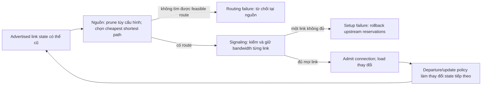

# L2.5 Part1 — state cũ trong routing làm đổi tải

Người phụ trách: **Doan Van Tai** · **26/10/2026**. Bản thực hiện AI; L-self/understanding
của tác giả chưa xác nhận. [Thẻ đọc](../../results/lessons/l2_5/reading_card.md) ·
[note P04](papers/P04.md) · [kết quả kiểm](../../results/lessons/l2_5/verification.json).

## Ý chính

P04 đã đặt câu hỏi stale link-state ảnh hưởng routing/overhead thế nào khi
admission làm đổi tài nguyên còn trống. Bài cần đọc vì nó có thể giới hạn
wording của PC2/PC3/PC4/PC6; năm2001 không làm prior đó mất liên quan.
Các kết luận bên dưới chỉ áp dụng đúng cấu hình/phạm vi nguồn đã đọc.

## Đọc đường đi của một connection

Đây là bản diễn giải §II-A/C/D, tr.163–165. P04 không model chi tiết distribution
protocol; flooding chỉ là một lựa chọn. Routing failure có thể do infeasibility
thật hoặc do prune sai; không phải mọi blocking đều do stale information.

## T khác age; age khác sai số

Với **chu kỳ đúng T, refresh tức thời, không jitter/delay**, và observation phase
U đều trên[0,T), age=U và E[age]=T/2. Đây là phép tính theo giả định đã nêu,
không phải số đo P04. Homogeneous Poisson arrivals độc lập với lịch refresh,
trong chế độ ổn định, là một điều kiện đủ cho arrival phase đều; chỉ nói
“đến ngẫu nhiên, không liên quan lịch” chưa mô tả đủ mọi trường hợp.

Nếu arrival rate là λ không đổi thì E[số request trong interval dài T]=λT;
không có nghĩa chúng cùng chọn một route, hoặc cùng dùng một database duy nhất
trong hệ nhiều router. P04 còn jitter từng link (§II-D). Vì vậy không gán
chính xác Uniform[0,T) hay age≤T của mô hình lý tưởng cho toàn bộ simulation.

Contract D8 cố định **age1s**, D20 còn cho biết **hai mode hiện tại**. κ=Tmode/age
là tọa độ timescale khác holding-time/update-period trong P04; chỉ so khái niệm
“độ cũ tương đối”, không đồng nhất biến hay thông số.

## Trigger không phải sai số tối đa trong mọi điều kiện

§II-D, tr.165 định nghĩa độ lệch trigger bằng sai khác reserved bandwidth chia
**available bandwidth đã quảng bá**. Với available a và advertised a'>0:

\[
e=|a-a'|/a'.
\]

Trong ideal pure-trigger với quan sát/phát update tức thời, không hold-down hoặc
transmission delay, ngưỡng có thể giữ độ lệch giữa các lần update trong vùng
đã định. Trong P04 còn **hold-down + refresh**: hold-down có thể chặn update
khi đã vượt trigger; refresh có thể cập nhật dù state không đổi. Không viết
“trigger luôn chặn error nhưng không chặn age” cho policy kết hợp này.

Counterexample đã chạy: advertised10, actual6 ở t1, threshold20%, hold-down5.
Update chưa được phép, residual error40%>20%. Đây là phản ví dụ lý tưởng cho
một bảo đảm vô điều kiện, không là replication implementation P04.

## Dịch P04 sang contract — không ép thành đúng bốn ô

| P04 | Gần phần nào của repo? | Giới hạn phép dịch |
|---|---|---|
| Period/trigger/hold-down/refresh | Cơ chế cập nhật observation | Không bằng fixed age1s hoặc toàn bộ D20 |
| Cost levels C | Độ phân giải metric và các ties khi xếp route | Không tự là observation refinement với policy cố định |
| Exponent α | Hình dạng link-cost heuristic | Không là mean-future→true-law D21 |
| Pruning | Route selection/admission heuristic | Thay luật dùng thông tin; logic repo giữ cố định |
| Reservation/release sau routing | Action tác động lên load | Paper đã có load-changing action; không claim mới |
| Blocking/overhead nhiều connection | Performance theo quá trình vận hành | Không có quy đổi trực tiếp sang packet·s regret D18 |

Trong các mục đã đọc, chưa xác nhận thiết kế tách đúng S0/S1 × M0/M1 theo
D20/D21. Điều đó không cho phép nói “P04 không xét model”. Không có raw four-cell
cost theo D19 trong lượt đọc này để tính Γ.

§V-A là tiền lệ cho **giá trị của độ phân giải metric phụ thuộc update policy**.
Fig.8(a) dùng blocking và tắt pruning; (b) dùng setup failures và bật pruning.
Giữ nhận xét định tính; không chứng nhận complements theo hiệu số hai hiệu số,
không suy Γ>0 hoặc bất kỳ nhãn PC3 nào từ hai panel.

## Toy của lesson — cùng10yêu cầu, A6/B4, demand1

Không departure; snapshot được lấy trước request đầu mỗi nhóm T; tie chọn A;
nếu database thấy cả hai link không đủ thì routing failure. Đây là ví dụ
connection admission, không là hai queue của contract.

| Policy | Admit /10 | Setup failure | Routing failure | Blocked fraction |
|---|---:|---:|---:|---:|
| Snapshot refresh mỗi request (T1) | 10 | 0 | 0 | 0% |
| Snapshot T5 | 9 | 1 | 0 | 10% |
| Snapshot T10 | 6 | 4 | 0 | 40% |
| Luân phiên A/B, không dùng load | 9 | 1 | 0 | 10% |

T5: năm request đầu cùng chọn A, còn(A1,B4); năm request sau cùng chọn B,
bốn được admit và một bị chặn. “Static luân phiên” trong lesson là **round-robin**,
không đồng nhất baseline static cố định route theo source–destination của P04.

Kiểm toàn bộ T1…T10 được lưu, không chỉ ba hàng thuận tiện. Có **T5 chặn1 nhưng
T6 chặn0**: phase/horizon alignment khiến toy hữu hạn không đơn điệu theo T.
Không dùng nó kết luận xu hướng trong Fig.1 của paper sai.

Mở rộng đúng toy không-departure tới40requests: tổng admit10, chỉ một lần đổi
route giữa các lần có chọn route, rồi cạn cả hai link. Vì vậy bảng10requests
minh họa dồn tải theo snapshot cũ; chưa mô tả sustained route flapping.
Flapping trong P04 còn có arrivals/departures và feedback lặp lại.

[Code](../../experiments/lessons/l2_5_stale_routing.py) ·
[Config](../../results/lessons/l2_5/config.json) ·
[Kết quả JSON](../../results/lessons/l2_5/toy_results.json) ·
[CSV tổng hợp](../../results/lessons/l2_5/summary.csv) ·
[Từng request](../../results/lessons/l2_5/trace.csv) ·
[Trigger trace](../../results/lessons/l2_5/trigger_trace.csv) ·
[Log](../../results/lessons/l2_5/run.log).

22 kiểm deterministic PASS; không có seed/CI vì đây là phép chạy hữu hạn đúng
cấu hình cho trước. Không đo blocking probability trên workload ngẫu nhiên,
không tái lập P04 hoặc chạy Phase3; không so blocked fraction này với1% regret.

## Điều đã biết, điều còn phải kiểm

Năm dòng prior có section nằm trong [note P04](papers/P04.md). §III-A/IV-A nói
hiệu ứng tùy traffic/topology. Còn §III-B/IV-A, tr.170–171, paper nêu trường hợp
**thông tin chính xác hơn có thể tăng blocking** qua pruning/nonminimal routes.
Vì vậy không khái quát “P04 chỉ có thông tin cũ gây hại” hay “refresh luôn tốt”.

Trong repo, D9 là posterior đúng từ observation cũ; “cũ” không đồng nghĩa
measurement sai hoặc model tin nhầm backlog cũ là backlog hiện tại. Cả M0/M1
tính tác động của u. One-shot loại vòng lặp nhiều quyết định, không làm prior
P04 mất liên quan và chưa xác nhận tính thực dụng của abstraction.

Đoạn trả lời reviewer — **AI draft, chưa phải đóng góp đã xác nhận**:

> Chúng tôi dùng một decision để tách quyền thông tin hiện tại khỏi cách biểu diễn
> randomness trong cùng model phản ứng load-aware. Vì vậy kết quả có điều kiện
> không bao phủ route flapping, nhiều controller hoặc resource competition qua
> nhiều admission. Việc định lượng có bổ sung gì ngoài prior P04 cần được kiểm
> bằng đúng estimand, hai can thiệp và null/confirmation của contract.

Đây không là phép phê duyệt H1 của A05: hàm, metric, biên và split ở D25 vẫn deferred.

## Trạng thái

- Đã thực hiện kỹ thuật Part1: P04 targeted + nhìn hình, note,5dòng prior,
  bảng dịch, đính chính lesson và toy/các bài tập số liên quan.
- Ba câu “dự đoán trước đọc” đã exposed trong attachment; không dựng receipt mù.
- Tác giả tự đọc §V-A/Fig.8, tự giải thích và L-self: **chưa có record mới**.
- Part2/M00/P01: **chưa thực hiện**, không ghi toàn bộ L2.5 đã đóng.
- G1, contract/claims/Gate và HOLD Phase4 giữ nguyên; không freeze prediction card.
