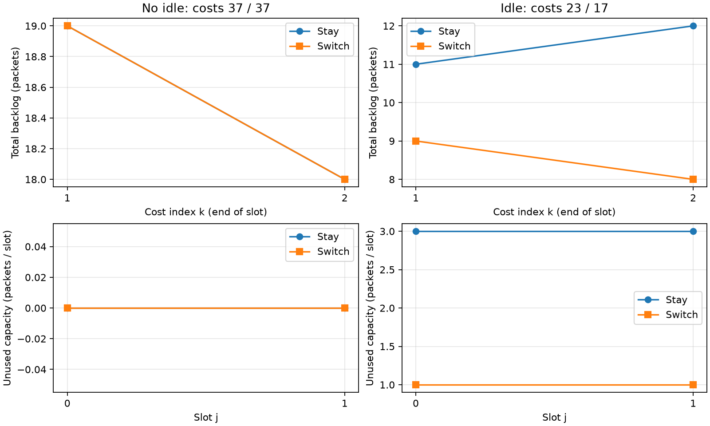

# L1.2 — kết quả chạy và đo

Lần chạy: 2026-10-09T21:04:56.632058+07:00.

Tác giả: **Doan Van Tai**. Thực hiện theo hai tài liệu L1.2 được cung cấp; experiment card lập trước khi chạy.
Kết quả là verification F1/D13 trên toy grid; không là evidence mạng hoặc record tác giả tự làm.

## Kiểm thử và vét cạn

- Bộ L1.2: **11/11 đạt**.
- Toàn repo: **22/22 đạt**.
- Lưới H=2: **5,832 cấu hình**, **0 vi phạm** đẳng thức hiệu cost.
- Không idle dưới cả hai action: **2,048 cấu hình** (35.12%); **0 sai khác cost**.
- u=0: **2,916 cấu hình**; kiểm bằng nhau về cost và idle trong test zero-action.
- Đối chiếu cost và idle từng action với verify_dl010.py trên toàn lưới: **0 sai khác**.
- Đây là số cấu hình/path không idle, chưa phải tỉ lệ state thuộc vùng bảo toàn của lưới D ở L1.8.

## Một queue — bài tính mẫu

| Slot | q trước | Arrivals | q+A−c | q sau | Idle | Phục vụ |
|---:|---:|---:|---:|---:|---:|---:|
| 0 | 4 | 2 | 3 | 3 | 0 | 3 |
| 1 | 3 | 5 | 5 | 5 | 0 | 3 |
| 2 | 5 | 1 | 3 | 3 | 0 | 3 |
| 3 | 3 | 0 | 0 | 0 | 0 | 3 |
| 4 | 0 | 0 | -3 | 0 | 3 | 0 |
| 5 | 0 | 6 | 3 | 3 | 0 | 3 |

q_cuối = phần tuyến tính 0 + idle 3 = 3.
Tổng đến 14 − tổng phục vụ 15 = −1 = q_cuối 3 − q₀ 4.

## Hai queue — cost đo từ q₁…q_H

Đơn vị: packet·slot với dt=1. Δ=C(Switch)−C(Stay); c_sw=0.

| Ví dụ | Stay | Switch | Δ | Idle Stay | Idle Switch | Hiệu idle có trọng số |
|---|---:|---:|---:|---|---|---:|
| dl010_no_idle | 37 | 37 | 0 | [0, 0] | [0, 0] | 0 |
| dl010_with_idle | 23 | 17 | -6 | [3, 3] | [1, 1] | -6 |
| canonical_B_on | 6 | 4 | -2 | [3, 0] | [1, 2] | -2 |
| canonical_B_off | 4 | 0 | -4 | [3, 3] | [1, 3] | -4 |
| exercise_4_restore_B_backlog | 34 | 34 | 0 | [0, 0] | [0, 0] | 0 |

Chi tiết A/B từng slot nằm trong [slot_tables.csv](slot_tables.csv).



## Bốn bug giả — lần chạy trong subprocess riêng

| Mutant | Bug | Test đỏ | Test xanh |
|---|---|---:|---:|
| B1 | Service trước arrivals; idle cũng theo model đó | 5/11 | 6 |
| B2 | Cộng backlog k=0 vào cost | 3/11 | 8 |
| B3 | Idle quên arrivals | 8/11 | 3 |
| B4 | Switch thêm u vào B nhưng giữ u ở A | 5/11 | 6 |

**B1** bắt bởi: `test_hand_table_one_queue`, `test_complementarity_backlog_times_idle_is_zero`, `test_dl010_question_2_with_idle`, `test_canonical_x_d_both_branches`, `test_negative_control_no_idle_means_equal_cost`.

**B2** bắt bởi: `test_dl010_question_1_no_idle`, `test_dl010_question_2_with_idle`, `test_canonical_x_d_both_branches`.

**B3** bắt bởi: `test_hand_table_one_queue`, `test_identity_linear_plus_idle`, `test_conservation_arrivals_minus_served`, `test_complementarity_backlog_times_idle_is_zero`, `test_dl010_question_2_with_idle`, `test_canonical_x_d_both_branches`, `test_identity_cost_difference_on_exhaustive_grid`, `test_negative_control_no_idle_means_equal_cost`.

**B4** bắt bởi: `test_dl010_question_1_no_idle`, `test_dl010_question_2_with_idle`, `test_canonical_x_d_both_branches`, `test_identity_cost_difference_on_exhaustive_grid`, `test_negative_control_no_idle_means_equal_cost`.

B1 vẫn qua hai đẳng thức/bảo toàn vì idle được đổi nhất quán với recurrence khác; golden và complementarity phát hiện sai ngữ nghĩa. B2 chỉ bị ba golden cost tuyệt đối bắt: cộng q₀ là hằng số chung nên mọi phép trừ che được lỗi.

## Minh họa đường trung bình (Part 1 §9.2)

B i.i.d. mỗi slot là 1 hoặc 5, mỗi giá trị xác suất 1/2; không phải law Markov của ví dụ chuẩn.
Liệt kê 4 path bằng Fraction: J(Stay)=45/2=22,5; J(Switch)=20; Δ=−5/2=−2,5.
Mean rollout cho 20/20, hoà chọn Stay; regret thật=5/2=2,5. Hiệu idle kỳ vọng có trọng số=−5/2.

## Provenance, phạm vi và cách tái chạy

Ba hàm nằm ở `experiments/lessons/l1_2_queue.py`; 11 test ở `tests/test_l1_2_queue.py`. Đáp án golden trong `tests/golden_phase1.py` được ghi từ tài liệu ngày 09/10/2026, không phải bài tính tay độc lập của Doan Van Tai. Đối chiếu hai implementation chưa đủ để gọi là independent review.
G1, V3/V10/V11 và HOLD Phase 4 giữ nguyên. Chưa kiểm mọi H, mạng thật, practical gain, novelty, hay toàn bộ pipeline Phase 3/A01. Plant Phase 3 vẫn cần golden do tác giả tự tính.

Thời gian wall-clock toàn runner: 3.392 s; bao gồm pytest, mutation, exact enumeration và tạo hình. Không là benchmark mạng.
Python 3.14.5; pytest 9.1.1. SHA-256 source và commit nền nằm trong `results.json`.

```bash
.venv/bin/python -m experiments.lessons.run_l1_2
.venv/bin/python -m pytest -q
```

Có thể dùng `--output-dir /tmp/l1_2-rerun` để lưu lần chạy khác; output mặc định được ghi lại khi tái chạy.

| File | Nội dung |
|---|---|
| [results.json](results.json) | Metrics, ví dụ, test/mutation counts, thời gian, provenance/hash |
| [grid_results.csv](grid_results.csv) | Toàn bộ 5.832 cấu hình, cost/idle, residual và đối chiếu |
| [slot_tables.csv](slot_tables.csv) | 46 dòng: một queue 6 slot + 5 ví dụ × 2 action × 2 queue × 2 slot |
| [lesson.txt](lesson.txt), [full_suite.txt](full_suite.txt) | stdout/stderr pytest thật; JUnit tương ứng *.xml |
| B1.txt…B4.txt, B1.xml…B4.xml | Test đỏ/xanh và lỗi của từng mutant; lỗi là có chủ đích |
| [reference_dl010.json](reference_dl010.json) | Chạy lại verify(): conservation và Markov/Jensen; phạm vi khác ví dụ i.i.d. |
| [queue_comparison.png](queue_comparison.png) | Hình từ số đo backlog/idle của hai ví dụ DL-010 |
