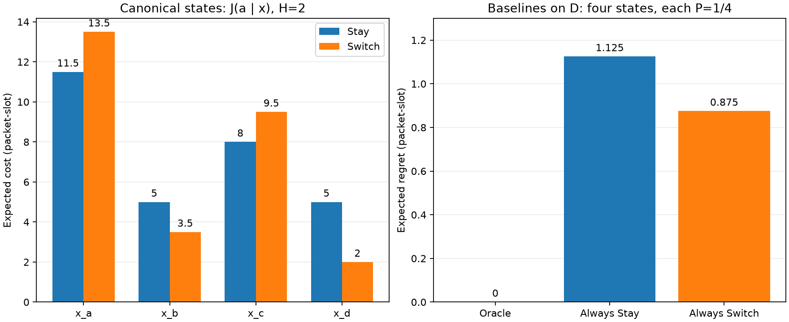

# L1.3 — expected cost, oracle và regret

Tác giả: **Doan Van Tai** · Ngày thực hiện: **21/10/2026** · Lần chạy: 2026-10-21T17:03:45.666103+07:00.

Đã triển khai sáu hàm theo hai phần L1.3, dùng lại plant L1.2. Experiment card lập trước khi chạy; không đổi recurrence, metric hoặc điều kiện thí nghiệm.

## Cấu hình và kết quả state

c_A=c_B=3, u=2, nền A=1, nền B on/off=5/0; p=s=1/2. H=2, dt=1, c_sw=0. y=(2,0) đầu slot −1, tau=1; mode lúc −1 có prior 1/2 độc lập với y. Trước t0 dùng Stay. Mode slot 0 thuộc state; chỉ slot 1 là tương lai. Hoà chọn Stay.

| State | (q_A,q_B,mode) | P_D | J Stay | J Switch | Δ | Oracle | P idle Stay | P idle Switch |
|---|---|---:|---:|---:|---:|---|---:|---:|
| x_a | (2,2,on) | 1/4 | 11.5 | 13.5 | +2 | Stay | 0 | 1 |
| x_b | (2,2,off) | 1/4 | 5 | 3.5 | -1.5 | Switch | 1 | 1 |
| x_c | (2,0,on) | 1/4 | 8 | 9.5 | +1.5 | Stay | 1/2 | 1 |
| x_d | (2,0,off) | 1/4 | 5 | 2 | -3 | Switch | 1 | 1 |

Mọi state có Δ khác 0 và có idle với xác suất dương dưới ít nhất một action; **0/4 state thuộc vùng bảo toàn**. Có idle là điều kiện cần, tự nó chưa đủ kết luận không suy biến.

## Baselines và oracle

Cost, Δ và regret có đơn vị **packet·slot**.

| Luật | Expected cost L | Expected regret | Giá trị chính xác (L; R) |
|---|---:|---:|---|
| Oracle | 6.25 | 0 | 25/4; 0 |
| Always Stay | 7.375 | 1.125 | 59/8; 9/8 |
| Always Switch | 7.125 | 0.875 | 57/8; 7/8 |

Oracle không thấu thị được dùng làm benchmark. Phép kiểm chẩn đoán E[min C] bằng min J ở cả bốn state, nên oracle thấu thị cũng có L=25/4 ở riêng ví dụ này; không suy ra kết quả cho law/H khác.
Tính bằng Fraction trên toàn cây: **không sai số lấy mẫu, không RNG/seed, không CI thống kê**. Bất định tương lai vẫn hiện diện trong law và đã được tích phân; chưa kiểm model uncertainty hoặc mạng thật.



## Bảng nhánh — kiểm nối L1.2

[future_branches.csv](future_branches.csv) chứa 8 nhánh (2/state), [slot_tables.csv](slot_tables.csv) chứa 64 dòng A/B theo action và slot. Tất cả cost và idle khớp bảng cung cấp; hiệu cost từng nhánh và kỳ vọng khớp tổng idle có trọng số, 0 vi phạm.

## Kiểm thử và mutation

- L1.3 theo tài liệu: **9/9 PASS**.
- L1.2 + L1.3 theo tài liệu: **20/20 PASS**.
- Ba test biên/nhiều bước bổ sung: **3/3 PASS**.
- Toàn repository: **34/34 PASS**.
- Con số 19 trong Part 1 ứng với 11+8 test trước test bất đối xứng; Part 2 dùng 11+9=20. Toàn repo còn có 11 test smoke/timescale và 3 test bổ sung, nên là 34.

Mutant chạy trong subprocess riêng, không sửa source baseline. FAIL dưới đây là lỗi được cài có chủ đích.

| Mutant | Bug | Test đỏ, bộ đầu (8) | Test đỏ, bộ cuối (9) |
|---|---|---:|---:|
| M1 | Hoà chọn Switch | 1/8 | 1/9 |
| M2 | Mode slot 0 bị phân nhánh thay vì cố định theo x | 3/8 | 4/9 |
| M3 | D12 bỏ chạy plant, giữ backlog y làm state hiện tại | 2/8 | 2/9 |
| M4 | Không nhân xác suất path cũ: dùng pm thay pr×pm | 1/8 | 1/9 |
| M5 | Expected cost lấy trung bình thường, bỏ trọng số xác suất | 0/8 | 1/9 |

**M1, test cuối bắt được:** `test_zero_action_gives_zero_delta`.

**M2, test cuối bắt được:** `test_expected_costs_match_hand_calculation`, `test_oracle_rule_on_means_stay_off_means_switch`, `test_oracle_cost_and_fixed_rule_regrets`, `test_asymmetric_chain_weights_branches_by_probability`.

**M3, test cuối bắt được:** `test_episodes_generated_from_plant_D12`, `test_oracle_cost_and_fixed_rule_regrets`.

**M4, test cuối bắt được:** `test_mode_path_probabilities_sum_to_one`.

**M5, test cuối bắt được:** `test_asymmetric_chain_weights_branches_by_probability`.

M5 lọt toàn bộ 8 test ban đầu: nhánh 1/2–1/2 che lỗi bỏ trọng số. Test bất đối xứng bắt được M5 với x_b,p=3/4,s=1/4: J(Stay)=11/2=5,5, J(Switch)=19/4=4,75. M4 chỉ lộ khi có nhiều bước chuyển; zero-action kiểm riêng luật hoà của M1.

## Các trường hợp bổ sung

- H=3,x_d: các tail on/on,on/off,off/on,off/off có xác suất 1/4; cost Stay=12/8/8/6, Switch=12/7/4/0; J=17/2 và 23/4.
- tau=0, prior_on=3/4: giữ nguyên backlog y, mode on/off có xác suất 3/4 và 1/4.
- tau=2,p=3/4,s=1/4,prior_on=3/4: 8 path gộp thành 6 state, tổng xác suất 1. [episode_paths.csv](episode_paths.csv) lưu cả trace chuẩn, tau=0 và tau=2.

Preflight trước khi hoàn thiện có **22 PASS, 1 FAIL**: bảng dự đoán bổ sung H=3 ghi nhầm Stay tail on/off là 7. Tính lại A=[2,2,2] (tổng 6), B=[0,2,0] (tổng 2) cho cost đúng 8, J Stay=17/2. Đã sửa dẫn giải/golden, giữ nguyên plant và đáp án tài liệu. Log lần lỗi lưu tại `notes/verification/l1_3/preflight.txt` và `preflight.xml` trong repo; experiment card giữ dự đoán ban đầu kèm đính chính.

## Kiểm toán EV-22

Chỉ dùng cấu hình được trích trong L1.3 Part 1 §13, chưa đối chiếu bản Master Plan gốc đầy đủ: B i.i.d. {0,2}, q=(2,0), H=2, c=3,u=2,b_A=1. Liệt kê 4 path cho J Stay=4, Switch=5/4 khi c_sw=0, Δ=−11/4. Cộng c_sw=3 như ví dụ cũ cho Switch=17/4=4,25, Δ=1/4; giá trị này chỉ để audit lịch sử, không đưa vào cấu hình thí nghiệm hiện hành.
Dưới Stay, A nhận đúng capacity nên q_A giữ nguyên: quan sát 0 không thể sinh state thật 2. EV-22 được ghi nhãn **ví dụ sổ sách, không phải episode sinh từ plant** dưới các giả định đã trích. Giữ bảng lịch sử và các phép tính đại số của nó; ví dụ chuẩn L1.3 dùng cho phần episode/J phía sau.

## File, tái lập và giới hạn

Source: `experiments/lessons/l1_3_expected_cost.py`; runner: `experiments/lessons/run_l1_3.py`; tests: `tests/test_l1_3_expected_cost.py`, `tests/test_l1_3_boundaries.py`; golden: `tests/golden_phase1.py`; experiment card: `notes/lessons/L1.3_experiment_card.md`.

```bash
.venv/bin/python -m experiments.lessons.run_l1_3
.venv/bin/python -m pytest -q
# Tái chạy sang thư mục khác để giữ artifact hiện tại:
.venv/bin/python -m experiments.lessons.run_l1_3 --output-dir /tmp/l1_3-rerun
```

| File | Nội dung |
|---|---|
| [config.json](config.json) | Cấu hình chính, biến thể, seed=null, metric và điều kiện |
| [results.json](results.json) | Kết quả chính xác, môi trường, command đã chạy, hash source/tài liệu nguồn |
| [state_costs.csv](state_costs.csv), [baselines.csv](baselines.csv) | J, Δ, oracle, P_idle, L và regret |
| [future_branches.csv](future_branches.csv), [slot_tables.csv](slot_tables.csv) | Cost/idle của từng nhánh, từng queue/slot |
| [episode_paths.csv](episode_paths.csv), [old_example_paths.csv](old_example_paths.csv) | Pre-t0 traces và bốn path audit EV-22 |
| lesson.txt, lessons.txt, boundaries.txt, full_suite.txt và *.xml | stdout/stderr và JUnit thật của baseline |
| M1_initial.txt…M5_initial.txt, M1_final.txt…M5_final.txt và *.xml | Kết quả mutation trước/sau test bất đối xứng |
| M1_patch.py…M5_patch.py | Code bug tách biệt để kiểm lại; không import trong test thông thường |
| [expected_costs.png](expected_costs.png) | Biểu đồ từ số liệu thực thi |

Golden ngày 21/10/2026 ghi từ tài liệu; chưa là xác nhận tác giả đã tự tính bài giấy. Các trường hợp bổ sung có dẫn giải exact riêng. Giữ G1, V3/V10/V11 và HOLD Phase 4. Không suy implementation hoàn thành thành hypothesis đúng, không tính G_S/G_M/Gamma trước L1.4.
Liệt kê cây tăng theo 2^(H−1); H=4 tối đa 8 nhánh, H=50 tối đa 562.949.953.421.312 nhánh/state cho chuỗi đầy đủ hai nhánh. Chưa chạy H=50, chưa implement lan truyền phân phối Phase 3. p=s=1/2 là chuỗi dạy học; kết quả chưa đại diện nguồn traffic vật lý.

Python 3.14.5; pytest 9.1.1. Wall time runner: 4.535 s (gồm test, mutation, exact enumeration, vẽ hình; không là benchmark mạng).
