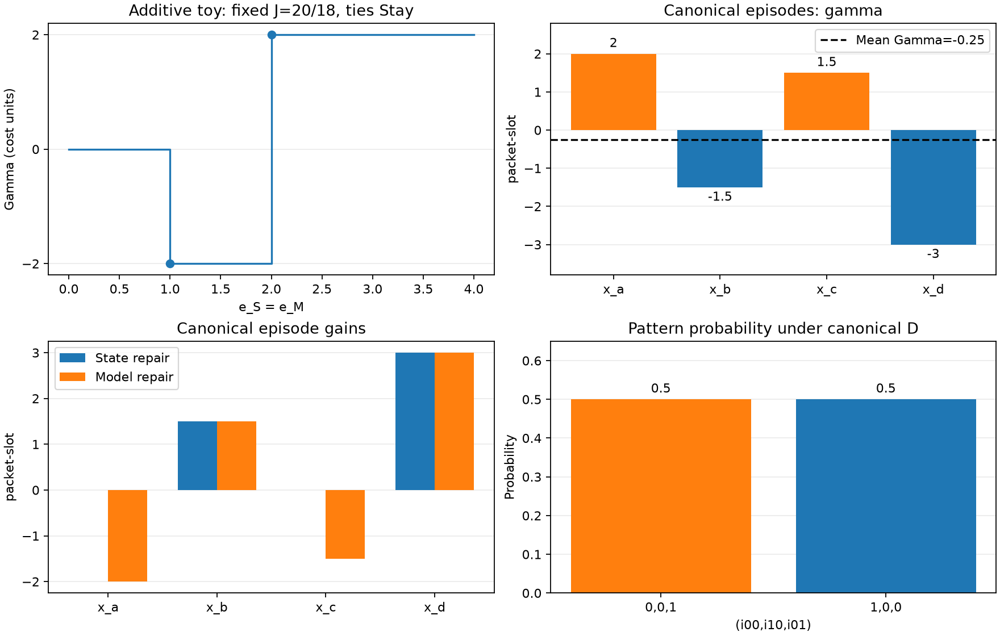

# L1.4 — sổ sách 2×2: kết quả chạy và đo

Tác giả: **Doan Van Tai** · Ngày thực hiện: **21/10/2026** · Lần chạy: 2026-10-21T18:31:32.154890+07:00.

Đã triển khai sáu hàm sổ sách D19, dùng J từ L1.3. Chỉ gap dự đoán được dùng để chọn action; J thật dùng sau quyết định để chấm điểm. Golden và experiment card được ghi trước khi chạy.

## Cấu hình và bảng chuẩn

H=2,dt=1,c_A=c_B=3,u=2,b_A=1,B on/off=5/0,p=s=1/2,c_sw=0. D sinh từ y=(2,0),tau=1,prior_on=1/2 độc lập observation, trước t0 dùng Stay; mỗi state có xác suất 1/4. Gap00=1/4, gap01=−1/4; gap10 theo x_a…x_d là 2,−1/2,2,−5/2; gap11=Δ thật. Đây là các dự đoán cho sẵn; nguồn gốc belief/model chờ L1.6. Đơn vị cost, gain, gamma: **packet·slot**.

| Episode | ℓ00 | ℓ10 | ℓ01 | ℓ11 | g_S | g_M | γ | Pattern |
|---|---:|---:|---:|---:|---:|---:|---:|---|
| x_a | 11.5 | 11.5 | 13.5 | 11.5 | 0 | -2 | 2 | (0,0,1) |
| x_b | 5 | 3.5 | 3.5 | 3.5 | 1.5 | 1.5 | -1.5 | (1,0,0) |
| x_c | 8 | 8 | 9.5 | 8 | 0 | -1.5 | 1.5 | (0,0,1) |
| x_d | 5 | 2 | 2 | 2 | 3 | 3 | -3 | (1,0,0) |

| Ô | Expected cost L | Expected regret R |
|---|---:|---:|
| 00 | 7.375 | 1.125 |
| 10 | 6.25 | 0 |
| 01 | 7.125 | 0.875 |
| 11 | 6.25 | 0 |

| G_S | G_M | G_SM | Γ | G_S given M1 | G_M given S1 |
|---:|---:|---:|---:|---:|---:|
| 1.125 | 0.25 | 1.125 | -0.25 | 0.875 | 0 |

Cell11 và cell10 đạt cost oracle L_*=25/4=6,25. Model repair có G_M=1/4 trung bình nhưng g_M âm ở x_a,x_c, chiếm **1/2 tổng xác suất D**. Gamma trung bình=−1/4, trong khi gamma episode từ −3 tới +2. Hai pattern (0,0,1) và (1,0,0) có xác suất 1/2 mỗi loại; toàn bộ gamma dương trong ví dụ này đến từ bù sai số, không phải pattern (1,1,1).

Nhóm mode on: G_M=−7/4, Gamma=7/4; mode off: G_M=9/4, Gamma=−9/4. Các nhóm theo mode thật chỉ là chẩn đoán evaluator, chưa là nhóm triển khai có thể quan sát trước action.



## Lưới và bất biến

- Lưới nửa đơn vị: **1,156 cấu hình**, 0 vi phạm (a),(b),(e).
- Lưới bước 1/6: **9,604 cấu hình**, 0 vi phạm (a),(b),(e).
- Cả hai lưới cộng tính chỉ cho hệ số gamma/margin thuộc {−1,0,1}; không có hệ số 2. Đây là số đếm thiết kế, không phải tần suất ước lượng cho phân phối D.
- Kiểm đủ 8 pattern cho Δ=−2 và +2: **16 trường hợp**, chạm đủ {−1,0,1,2}; hai trường hợp hệ số 2 cho gamma=4. Margin bằng 0 cho mọi contrast bằng 0.
- Tuyến tính và đồng nhất thức theo cả cost lẫn regret đúng chính xác ở bảng chuẩn, 0 vi phạm.

**Giới hạn cộng tính (E0).** Với gap11=Δ và I_delta=0: gap00=gap10+gap01−Δ. Nếu Δ<0, hai ô 10/01 sai nghĩa là gap10,gap01≥0, kéo gap00>0 nên ô 00 cũng sai. Nếu Δ>0, hai ô đó sai nghĩa là gap10,gap01<0, kéo gap00<0 nên ô 00 cũng sai. Vậy pattern (0,1,1) không thể xuất hiện và gamma≤|Δ|. Khi Δ≠0 và cell11 là oracle chính xác, gamma=2|Δ| bác bỏ cộng tính ở episode đó; chưa xác định nguyên nhân là queue hay predictor/estimator phi tuyến.

Ở Phase 3, test (b) phải chạy trên dự đoán thực M0/M1, cùng golden bất đối xứng và test tại điểm hoà. Lưới cộng tính không bao phủ hết các pattern.

## Part A: các phép kiểm sổ sách

- Quét e=0,1/2,…,4: Gamma=0,0,−2,−2,2,2,2,2,2. Cost 20/18 giữ nguyên.
- Chỉ tại điểm hoà e_S=3/2,e_M=1/2: tie Stay cho Gamma=−2, tie Switch cho 0. D16 thực thi vẫn là tie Stay; phương án kia chỉ để chẩn đoán.
- Mixture p=7/10 cho Gamma=4/5; p=1/2 cho 0 dù mọi episode có |gamma|=2.
- EV-26: R không sửa=1, sửa hết state=1, sửa một nửa=0. Full gain=0, half gain=1=R00; gain oracle repair không là cận trên chung.
- Bất đối xứng e_S=3,e_M=1/2 cho G_S=2,G_M=0; đảo hai lỗi cho G_S=0,G_M=2.

## Tests và năm bug giả

- L1.4 theo tài liệu: **12/12 PASS**.
- Ba lesson theo tài liệu: **32/32 PASS**.
- Kiểm pattern/margin bổ sung: **2/2 PASS**.
- Toàn repo: **48/48 PASS**.

32 test trong tài liệu là 11+9+12; repo có thêm 11 smoke/timescale, 3 kiểm bổ sung L1.3 và 2 kiểm bổ sung L1.4, nên tổng là 48. Các FAIL mutant sau đây có chủ đích; mỗi mutant chạy ở subprocess riêng, không thay source baseline.

| Bug | Mô tả | Test đỏ ban đầu /11 | Test đỏ cuối /12 |
|---|---|---:|---:|
| N1 | Đảo dấu Gamma | 7 | 7 |
| N2 | G_S\|M1 copy nhầm công thức G_M | 3 | 3 |
| N3 | Hoà chọn Switch | 2 | 2 |
| N4 | Additive cells đổi nhãn state repair và model repair | 0 | 1 |
| N5 | Tại điểm hoà, dùng J thật để chọn action | 2 | 2 |

**N1**, test cuối bắt: `test_20_18_complements_when_errors_large`, `test_20_18_substitutes_when_errors_medium`, `test_tie_rule_is_part_of_definition`, `test_gamma_is_a_step_function_of_error_size`, `test_average_can_hide_opposite_signs_EV25`, `test_property_e_gamma_is_change_in_conditional_gain`, `test_canonical_table_golden`.

**N2**, test cuối bắt: `test_property_a_cell_11_is_oracle`, `test_property_e_gamma_is_change_in_conditional_gain`, `test_canonical_table_golden`.

**N3**, test cuối bắt: `test_tie_rule_is_part_of_definition`, `test_gamma_is_a_step_function_of_error_size`.

**N4**, test cuối bắt: `test_asymmetric_errors_distinguish_state_from_model`.

**N5**, test cuối bắt: `test_tie_rule_is_part_of_definition`, `test_gamma_is_a_step_function_of_error_size`.

N4 đổi nhãn S/M lọt toàn bộ 11 test ban đầu, kể cả ba tính chất, rồi bị golden bất đối xứng bắt. Mutation này tác động `additive_cells`; bảng chuẩn cho gaps trực tiếp không đi qua hàm đó. Các bất biến đối xứng tự chúng chưa kiểm được ngữ nghĩa nhãn.
N1 đảo dấu vẫn qua test (b) trên lưới cộng tính, nhưng bị test bổ sung đủ pattern bắt khi hệ số 2 biến thành −2. N5 bị bắt tại điểm hoà vì dùng cost thật để chọn vi phạm quyền thông tin.

Lần runner đầu dừng sau 48/48 test PASS vì phép chia cost nguyên tạo nhãn hệ số float (-1.0,0.0,1.0), khác nhãn Fraction được kiểm. Đã sửa bằng Fraction trước phép chia; không đổi công thức, golden hay cấu hình. Record lỗi tại `notes/verification/l1_4/development_issue.json` trong repo.

## File và tái chạy

Source: `experiments/lessons/l1_4_factorial.py`; runner: `experiments/lessons/run_l1_4.py`; tests: `tests/test_l1_4_factorial.py`, `tests/test_l1_4_patterns.py`; golden: `tests/golden_phase1.py`; card: `notes/lessons/L1.4_experiment_card.md`.

```bash
.venv/bin/python -m experiments.lessons.run_l1_4
.venv/bin/python -m experiments.lessons.run_l1_4 --output-dir /tmp/l1_4-rerun
```

| Artifact | Nội dung |
|---|---|
| [config.json](config.json), [results.json](results.json) | Cấu hình, metric/seed, kết quả exact, commands, source/document hashes |
| [canonical_cells.csv](canonical_cells.csv) | 16 dòng: gap, action, cost và regret của từng ô |
| [canonical_episodes.csv](canonical_episodes.csv), [canonical_means.csv](canonical_means.csv) | Bốn episode, L/R trung bình và sáu contrast |
| [pattern_distribution.csv](pattern_distribution.csv), [canonical_by_mode.csv](canonical_by_mode.csv) | Pattern có trọng số D, chẩn đoán theo mode thật |
| [coarse_grid.csv](coarse_grid.csv), [fine_grid.csv](fine_grid.csv), [all_patterns.csv](all_patterns.csv) | Toàn lưới và 16 trường hợp pattern |
| [error_sweep.csv](error_sweep.csv), [mixtures.csv](mixtures.csv), [partial_repairs.csv](partial_repairs.csv), [tie_diagnostic.csv](tie_diagnostic.csv) | Part A |
| lesson.txt, lessons.txt, patterns.txt, full_suite.txt và *.xml | stdout/stderr và JUnit thật |
| N1_initial.txt…N5_initial.txt, N1_final.txt…N5_final.txt, *.xml, N1_patch.py…N5_patch.py | Bug cụ thể và kết quả trước/sau golden bất đối xứng |
| N1_all_patterns.txt/xml | Kiểm riêng khả năng bắt đảo dấu khi chạm hệ số 2 |
| [factorial_results.png](factorial_results.png) | Hình dựng từ số liệu đã chạy |

Đây là verification E0/E1 trên cấu hình khai báo, chưa là evidence mạng hoặc xác nhận hypothesis/novelty. Golden ghi từ đáp án tài liệu ngày 21/10/2026, chưa thay bài tác giả tự tính. Chưa suy ra S0/M0/M1 end-to-end hoặc kiểm null L1.5. Giữ G1,V3/V10/V11 và HOLD Phase 4.
Không có RNG/seed, Monte Carlo hoặc CI lấy mẫu; số học int/Fraction chính xác. Bất định tương lai trong J được tích phân theo law L1.3, không phải đã loại bỏ mọi model uncertainty.
Python 3.14.5, pytest 9.1.1; wall time runner 5.940 s (không phải benchmark mạng).
