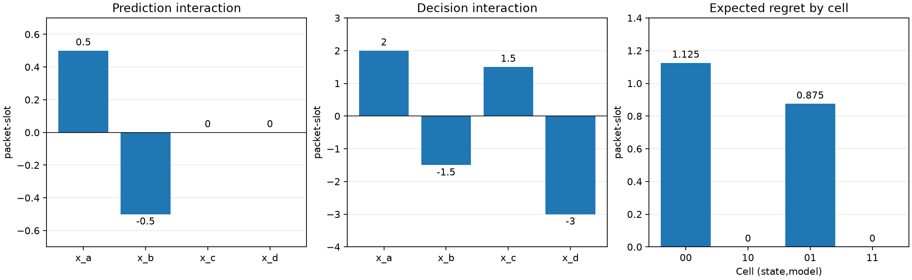

# L1.5 — F5, I_Δ và giới hạn của phép kiểm belief

Tác giả: **Doan Van Tai** · Ngày thực hiện: **21/10/2026** · Lần chạy: 2026-10-21T20:19:33.686355+07:00.

Triển khai 5 hàm, giữ plant/cost/D của L1.3–L1.4, hoà Stay. F5 không gọi choose; regret trực tiếp gọi choose L1.4 rồi mới dùng J để chấm. Các dự đoán M0 và belief cho sẵn, chưa implement pipeline L1.6.

## Bảng chuẩn

H=2,dt=1,c=3,u=2,b_A=1,B on/off=5/0,p=s=1/2,c_sw=0; y=(2,0),tau=1. Bốn state có cùng observation và xác suất 1/4. Cost/regret/gap/I/gamma có đơn vị **packet·slot**.

| State | Δ | M0 gap | e_M | I_Δ | gamma |
|---|---:|---:|---:|---:|---:|
| x_a | 2 | 2 | 0 | 0.5 | 2 |
| x_b | -1.5 | -0.5 | 1 | -0.5 | -1.5 |
| x_c | 1.5 | 2 | 0.5 | 0 | 1.5 |
| x_d | -3 | -2.5 | 0.5 | 0 | -3 |

d00=1/4,d01=−1/4; E_b[e_M]=1/2. I(x)=E_b[e_M]−e_M(x) khớp ở cả bốn state.
**E_D[I_Δ|y]=0**, nhưng **E_D|I_Δ|=1/4=0,25**. Mean bằng 0 không có nghĩa mọi I bằng 0. Phân phối exact: I=−1/2 có xác suất 1/4, I=0 có 1/2, I=1/2 có 1/4.

| Ô | Decision consistency | Expected regret |
|---|---:|---:|
| 00 | 50% | 1.125 |
| 10 | 100% | 0 |
| 01 | 50% | 0.875 |
| 11 | 100% | 0 |

Cả **16 cặp episode–ô** khớp golden và hai đường tính regret. Ô 00 và ô 01 cùng consistency 50% nhưng regret 9/8 và 7/8, vì margin của các lựa chọn sai khác nhau.



## Lưới kiểm và bounds nền

- F5: **81 cặp** Δ,Δ_hat từ −2 tới 2 bước 1/2; 0 sai khác direct/F5. Có 9 cặp predicted tie và 9 cặp true tie, giao nhau tại (0,0).
- Golden tie Δ=−11/4,+11/4,0 cho regret=11/4,0,0. Không bỏ số hạng hoà.
- **12,288 cấu hình** (3 belief × 4096 bộ số): mean I theo chính belief bằng 0; checker dùng sum trực tiếp, 0 vi phạm. Tự lấy mean theo belief đang dùng là kiểm đại số, chưa kiểm b=P_D(x|y).
- Bound sai số gap nhỏ hơn margin: 24 cặp thỏa tiền đề đều regret=0. Bound cost error≤b cho regret≤2b: **324 cấu hình, 0 vi phạm** (có lặp khi b=0). Đây là E0 đã biết.

## Sức phát hiện và giới hạn của guard mean-zero

| Kịch bản | Mean I theo D | Guard mean-zero |
|---|---:|---|
| matched | 0 | thoả |
| detectable_mismatch | 1/8 | bị vi phạm |
| undetected_mismatch | 0 | thoả |
| different_beliefs_cells_00_01 | 7/8 | bị vi phạm |

Hai kịch bản mismatch là phép reweight chẩn đoán có chủ đích, không thay D chuẩn của plant. D=(3/8,1/8,3/8,1/8) làm mean=1/8. D=(1/4,1/4,3/8,1/8) cũng khác b nhưng mean=0 vì cùng kỳ vọng sai số model. Vì vậy D≠b **không luôn** kéo mean≠0; phép kiểm có sức phát hiện ở trường hợp đã thử nhưng chưa đủ chứng nhận posterior. Dùng belief khác giữa cell00 và cell01 làm mean=7/8 ở ví dụ thử.
Guard bị vi phạm ở ví dụ cố ý sai nghĩa là test kiểm sức phát hiện phải **PASS**. Tài liệu có câu lẫn trạng thái PASS của test với trạng thái guard; note đặc tả đã làm rõ.
Nhóm mode thật on/off có mean=1/4 và −1/4; guard theo y không áp cho các nhóm đó. Sai khác mean cũng có thể do bug/aggregation sai giả định, không chỉ do belief.

I không bắt buộc đi cùng gamma: x_c có I=0,gamma=3/2; gaps=(4,3,2,5),J=(10,15) cho I=4,gamma=0. Thêm common error e0=−1,0,1 vào mô hình cộng đều cho I=0, kể cả khi cell11 chưa là oracle.

## Mutation và tính độc lập của người chấm

- L1.5 theo tài liệu: **11/11 PASS**.
- Bốn lesson theo tài liệu: **43/43 PASS**.
- Kiểm giới hạn bổ sung: **2/2 PASS**.
- Toàn repo: **61/61 PASS**.

43=11+9+12+11 là số test trong tài liệu; toàn repo còn 11 smoke/timescale, 3 kiểm thêm L1.3, 2 kiểm thêm L1.4 và 2 kiểm thêm L1.5, nên có 61. Checker cũ được dựng lại trong file riêng, chỉ đổi assert mean-zero từ sum độc lập sang belief_average; không tuyên bố repo từng dùng phiên bản cũ đó. Mutant chạy ở subprocess riêng; FAIL sau đây có chủ đích.

| Bug | Mô tả | Test đỏ checker dùng chung /11 | Test đỏ checker độc lập /11 |
|---|---|---:|---:|
| P1 | F5 bỏ số hạng hoà | 2 | 2 |
| P2 | F5 dùng <=, đếm hoà như sai dấu | 2 | 2 |
| P3 | I_delta đổi dấu số hạng d10 | 6 | 6 |
| P4 | belief_average bỏ trọng số | 1 | 2 |
| P5 | Cell01 dùng M0 thay cho delta thật | 6 | 6 |

**P1, checker cuối bắt bởi:** `test_F5_tie_term_running_example`, `test_F5_equals_direct_regret_on_grid_including_ties`.

**P2, checker cuối bắt bởi:** `test_F5_tie_term_running_example`, `test_F5_equals_direct_regret_on_grid_including_ties`.

**P3, checker cuối bắt bởi:** `test_i_delta_canonical_golden`, `test_i_delta_equals_belief_mean_error_minus_state_error`, `test_mean_i_delta_given_y_is_zero_canonical`, `test_mean_zero_holds_for_any_belief_and_any_numbers`, `test_limitation_grouping_by_true_mode_is_not_zero`, `test_dispersion_is_the_informative_diagnostic`.

**P4, checker cuối bắt bởi:** `test_mean_zero_holds_for_any_belief_and_any_numbers`, `test_mean_nonzero_when_belief_does_not_match_D`.

**P5, checker cuối bắt bởi:** `test_i_delta_canonical_golden`, `test_i_delta_equals_belief_mean_error_minus_state_error`, `test_mean_i_delta_given_y_is_zero_canonical`, `test_mean_zero_holds_for_any_belief_and_any_numbers`, `test_limitation_grouping_by_true_mode_is_not_zero`, `test_dispersion_is_the_informative_diagnostic`.

P4 làm cả implementation và checker cũ cùng lấy trung bình thường: test any-belief xanh sai. Checker độc lập có trọng số bắt được P4; trong bộ cũ P4 chỉ bị test mismatch bắt tình cờ.
Cross-module: sửa choose L1.4 thành tie Switch trước khi import L1.5 làm đúng 2 test điểm hoà/lưới F5 đỏ. Điều này xác nhận F5 không dùng chung logic choose bị hỏng với direct regret.

## Spec, H0 và file

[Note đặc tả](../../lessons/L1.5_identity_diagnostic_spec.md) ghi F5/F6, điều kiện mean-zero, rà shared computation của test L1.2–L1.4, đoạn H0 ≤10 dòng và việc mang sang L1.8. H0 chỉ kiểm được khi family/features, split theo workload/parameter, ngân sách fit và metric/biên lỗi được khoá, fit trên calibration rồi dự báo held-out. True gaps/errors của test chỉ evaluator dùng để chấm targets.
**Chưa fit H0/H1, chưa chấm held-out và chưa kiểm RQ2.** I khác 0 không chứng minh queue mechanism. Báo E|I| và phân phối; δ cho P(|I|>δ), convention quantile, C_ref và epsilon_E chính thức còn chờ L1.8. Không chọn δ hoặc báo tỷ lệ đáng kể sau khi xem kết quả.

```bash
.venv/bin/python -m experiments.lessons.run_l1_5
.venv/bin/python -m experiments.lessons.run_l1_5 --output-dir /tmp/l1_5-rerun
```

| File | Nội dung |
|---|---|
| [config.json](config.json), [results.json](results.json) | Cấu hình, exact metrics, source/doc hashes, commands và scope |
| [canonical_states.csv](canonical_states.csv), [canonical_regrets.csv](canonical_regrets.csv) | I/error/gamma 4 state và regret theo 16 cặp |
| [consistency_regret.csv](consistency_regret.csv), [i_delta_distribution.csv](i_delta_distribution.csv) | Consistency, regret và CDF exact |
| [f5_grid.csv](f5_grid.csv), [belief_grid.csv](belief_grid.csv), [cost_error_bounds.csv](cost_error_bounds.csv) | 81, 12.288 và 324 cấu hình |
| [belief_diagnostics.csv](belief_diagnostics.csv), [belief_diagnostic_states.csv](belief_diagnostic_states.csv), [hidden_mode_groups.csv](hidden_mode_groups.csv) | Phát hiện mismatch, blind spot, nhóm mode |
| [additive_common_error.csv](additive_common_error.csv) | Common error e0 và I dưới cộng tính |
| lesson.txt, lessons.txt, limits.txt, full_suite.txt và *.xml | Log/JUnit baseline thật |
| P*_coupled.txt, P*_independent.txt và *.xml; P*_patch.py | Replay checker cũ, checker cuối và năm bug cụ thể |
| coupled_checker/test_l1_5_identity.py | Bản test dùng chung helper, chỉ phục vụ replay |
| cross_choose.txt/xml, cross_choose_patch.py | Lỗi choose L1.4 bị test L1.5 phát hiện |
| [identity_diagnostics.png](identity_diagnostics.png) | Biểu đồ từ số đo |

Source: `experiments/lessons/l1_5_identity.py`, runner `experiments/lessons/run_l1_5.py`; tests `tests/test_l1_5_identity.py`, `tests/test_l1_5_diagnostic_limits.py`; golden `tests/golden_phase1.py`. Golden ghi từ tài liệu ngày 21/10/2026; chưa là bài giấy của tác giả. Không sửa snapshot contract-v0; note chỉ chuẩn bị contract-v1.
Exact int/Fraction, không RNG/seed/Monte Carlo hoặc CI lấy mẫu. Verification E0/E1 không xác nhận hypothesis, posterior S0, novelty hay network validity. Giữ G1,V3/V10/V11 và HOLD Phase 4.
Python 3.14.5, pytest 9.1.1; wall time runner 8.149 s (không là benchmark mạng).
