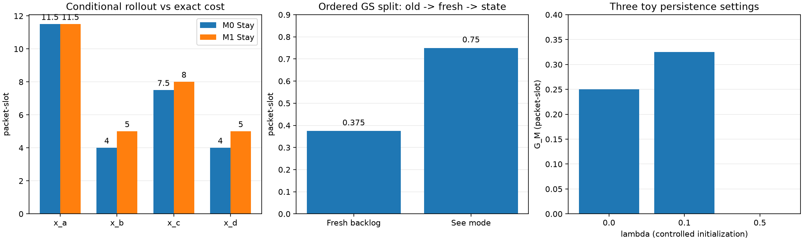

# L1.6 A–D — belief, M0 và 2×2 end-to-end

Tác giả: **Doan Van Tai** · Ngày: **22/10/2026** · Lần chạy: 2026-10-22T11:20:58.778686+07:00.

Đã triển khai B2 với likelihood 0/1, M0 có conditional means, shared-belief predict, factorial end-to-end và ô backlog hiện tại. Plant, exact J, choose, contrasts và F5 được dùng lại từ L1.2–L1.5.

## Cấu hình và dự đoán

H=2,dt=1,c=3,u=2,b_A=1,B on/off=5/0,p=s=1/2,c_sw=0. History=[(-1,(2,0))],prior_D=prior_S0=1/2. Đo backlog đầu slot không nhiễu, không thấy mode. Trước t0 dùng Stay; S0 posterior b=1/4 mỗi state, đã so trực tiếp với evaluator/golden. Không cấp D hoặc state thật cho hai quyết định S0. Đơn vị cost/gain/regret: **packet·slot**.

| State | M0 Stay | M1 Stay | M0 Switch | M1 Switch | e_M | I_Δ |
|---|---:|---:|---:|---:|---:|---:|
| x_a | 11.5 | 11.5 | 13.5 | 13.5 | 0 | 0.5 |
| x_b | 4 | 5 | 3.5 | 3.5 | 1 | -0.5 |
| x_c | 7.5 | 8 | 9.5 | 9.5 | 0.5 | 0 |
| x_d | 4 | 5 | 1.5 | 2 | 0.5 | 0 |

S0M0 predicts Stay=6,75,Switch=7 → gap=+0,25 → Stay. S0M1 predicts Stay=7,375,Switch=7,125 → gap=−0,25 → Switch. S1M0 và S1M1 chọn theo state và cùng đạt oracle ở ví dụ chuẩn. Dự đoán giờ được tính từ history/model, không nhập gap cho sẵn.

| Ô | L | R |
|---|---:|---:|
| 00 | 7.375 | 1.125 |
| 10 | 6.25 | 0 |
| 01 | 7.125 | 0.875 |
| 11 | 6.25 | 0 |

| G_S | G_M | G_SM | Γ | G_S given M1 | G_M given S1 |
|---:|---:|---:|---:|---:|---:|
| 1.125 | 0.25 | 1.125 | -0.25 | 0.875 | 0 |

Tái lập đúng L1.4–L1.5. G_S given M1=7/8 có dạng EVPPI về state hiện tại dưới posterior đúng; không phải biết trước future và không là contribution mới. Chưa đọc/đối chiếu P11 gốc; note ghi câu hỏi cho Phase2a.

## Jensen, posterior và lưới

- **864** cấu hình matched prior: b=D/reference, cell01=Bayes, G_M≥0, mean I theo history=0; 0 vi phạm.
- **6696** cặp state/action: M0≤M1 và Jensen gap bằng chênh lệch idle có trọng số; 0 vi phạm.
- F5 và (a),(b),(e) kiểm trên dự đoán thực: **13392** cặp episode/cell; 222 trường hợp state margin=0 được xử lý riêng, không chia margin0.
- **576** trường hợp S0 prior1/2 sai: đúng **5** ô G_M<0. Lưu cả toàn bộ lưới, không chỉ các ô âm. Ví dụ rate_on4,u1,y=(4,3),p=s=1/2,prior_D3/4 cho G_M=−3/16.
- Reference evaluator dùng Cartesian mode product và direct transition products, không gọi S0 hoặc mode_paths; vẫn dùng chung plant đã kiểm. Các history có loại trừ, prior thay đổi, τ3/nonzero-off có posterior/evidence/path records riêng.
- Với hai observation (2,0)→(2,2),p=s=3/4: evidence=1/2 ở prior1/2 và1/4 ở prior1/4, cùng posterior 9/16,3/16,3/16,1/16. Joint P(qB4,on)=9/16 khác tích marginals15/32. History (2,0)→(2,1) có evidence0 và bị từ chối đúng dự kiến.

M0≤M1 cần infinite buffer, mean đúng và cost backlog tuyến tính. Sai số gap có thể âm: iid toy q=(0,0),B={0,2} cho e_M=−5/4. Đây là toy khác, không đổi ngữ nghĩa known-slot0 của ví dụ chuẩn. EV-20 q0=20,H3 cho true/mean cost60; q0=0,H2,arrivals2/4 cho true cost5/4,mean cost0.

## Freshness, B1 và variants

Ô backlog hiện tại giấu mode có cost **7** ở cả M0/M1. Theo thứ tự tau1→tau0→S1: **freshness=3/8=0,375**, **mode visibility=3/4=0,75**, tổng9/8. Hai phần ba GS đến từ thấy mode; không gán phần này cho refresh backlog thực tế. Ô tau0 là diagnostic condition D, chưa tính delay/cost telemetry.

| Scenario | G_S | G_M | Gamma |
|---|---:|---:|---:|
| canonical | 9/8 | 1/4 | -1/4 |
| p55 | 979/800 | 13/40 | -13/40 |
| p75_controlled | 31/32 | 0 | 0 |
| p75_empty_conditioned_prior | 45/64 | 0 | 0 |
| two_observations_up | 21/32 | 0 | 0 |

GS không được suy đơn điệu từ các hàng conditional có D/history khác nhau. Prior1/4 chỉ mô tả biến thể điều kiện B rỗng trong luật cụ thể; chưa chạy warm-up/stationary simulation.
B1 sensitivity thử đủ bốn lựa chọn joint-MAP tied: mode on cho GS9/8,mode off7/8,GM0; ghi rõ lựa chọn, không đổi baseline B2. State-mean shortcut cho Stay4,5/Switch6,5, khác B2 M0 6,75/7; shortcut chỉ minh hoạ lỗi, không dùng trong pipeline.



## Kiểm thử và mutation

- L1.6 theo tài liệu: **16/16 PASS**.
- Năm lesson theo tài liệu: **59/59 PASS**.
- Reference/schema bổ sung: **3/3 PASS**.
- Toàn repo: **80/80 PASS**.

59=43+16 là số test trong tài liệu. Repo có 18 test ngoài bộ lesson trước đó và 3 kiểm mới nên tổng 80. Preflight19 đã chạy khi ghi experiment card; đây là verification theo kỳ vọng tài liệu, không là preregistration held-out.

| Mutant | Bug cụ thể | Test đỏ /16 | Test function đỏ | Trong 5 test chuẩn |
|---|---|---:|---:|---:|
| Q1 | Bỏ chuẩn hoá belief | 2 | 2 | 0 |
| Q2 | Bỏ likelihood, giữ cả chuỗi không khớp observation | 3 | 3 | 0 |
| Q3 | M0 dùng stationary mean từ slot1 thay conditional mean | 3 | 3 | 0 |
| Q4 | M1 dùng uniform belief khác belief của M0 | 4 | 2 | 0 |
| Q5 | S0 ép prior=1/2 | 2 | 1 | 0 |

**Q1** bắt bởi: `test_belief_two_observations_eliminates_and_renormalises`, `test_belief_is_joint_not_product_of_marginals`.

**Q2** bắt bởi: `test_belief_two_observations_eliminates_and_renormalises`, `test_belief_is_joint_not_product_of_marginals`, `test_impossible_observation_raises`.

**Q3** bắt bởi: `test_property_7h_m0_never_above_m1_on_grid`, `test_the_7c_check_can_fail_when_prior_is_wrong`, `test_persistence_variants_golden`.

**Q4** bắt bởi: `test_property_7c_bayes_decision_on_grid[prior_D0]`, `test_property_7c_bayes_decision_on_grid[prior_D1]`, `test_property_7c_bayes_decision_on_grid[prior_D2]`, `test_the_7c_check_can_fail_when_prior_is_wrong`.

**Q5** bắt bởi: `test_property_7c_bayes_decision_on_grid[prior_D0]`, `test_property_7c_bayes_decision_on_grid[prior_D2]`.

Số test đỏ là kết quả của các mutant được lưu cụ thể; tham số pytest được tính thành các test riêng. Theo test function, số đỏ là 2/3/3/2/1, khớp bảng tài liệu; theo pytest collected cases là 2/3/3/4/2 vì parametrization prior. Cả năm mutant đều qua các test ví dụ chuẩn; chúng lộ ở histories/priors/persistence hoặc tính chất trên lưới.
Q6 bổ sung (M0 bỏ rate_off) lọt 16/16 test gốc, bị 1/3 test bổ sung bắt. Các FAIL mutant là có chủ đích; không sửa source baseline hoặc sao chép repository.

## File, giới hạn và tái chạy

Source: `experiments/lessons/l1_6_belief.py`; reference `l1_6_reference.py`; runner `run_l1_6.py`; tests `tests/test_l1_6_belief.py`, `tests/test_l1_6_reference.py`; golden `tests/golden_phase1.py`. Card/spec tại `notes/lessons/L1.6_experiment_card.md` và `L1.6_belief_model_spec.md`.

```bash
.venv/bin/python -m experiments.lessons.run_l1_6
.venv/bin/python -m experiments.lessons.run_l1_6 --output-dir /tmp/l1_6-rerun
```

| Artifact | Nội dung |
|---|---|
| [config.json](config.json), [results.json](results.json) | Configuration, exact metrics, commands, hashes, scope |
| [canonical_states.csv](canonical_states.csv), [canonical_cells.csv](canonical_cells.csv), [canonical_means.csv](canonical_means.csv) | M0/M1/gaps/I/contrasts và 16 quyết định được sinh end-to-end |
| [canonical_jensen.csv](canonical_jensen.csv), [jensen_grid.csv](jensen_grid.csv) | Jensen gap và idle identity cho state/action |
| [matched_prior_grid.csv](matched_prior_grid.csv), [wrong_prior_grid.csv](wrong_prior_grid.csv), [wrong_prior_negative_cases.csv](wrong_prior_negative_cases.csv) | Toàn bộ 864 matched,576 wrong,5 negative cases |
| [posterior_states.csv](posterior_states.csv), [history_paths.csv](history_paths.csv) | Evidence, normalized posterior và path filtering |
| [persistence_variants.csv](persistence_variants.csv), [B1_sensitivity.csv](B1_sensitivity.csv), [jensen_toy_paths.csv](jensen_toy_paths.csv) | Sensitivities và toy Jensen |
| lesson.txt,lessons.txt,reference.txt,full_suite.txt và *.xml | Baseline stdout/stderr và JUnit |
| Q1.txt…Q5.txt, Q6_core.txt,Q6_extra.txt,*.xml,Q*_patch.py | Mutants cụ thể, log và test bị bắt |
| [belief_pipeline.png](belief_pipeline.png) | Biểu đồ từ số liệu |

Exact int/Fraction, không RNG/seed/Monte Carlo hoặc CI lấy mẫu. Đây là finite verification E0/E1 và toy discovery, chưa là evidence mạng, practical gain hoặc novelty. Không fit H0/H1, chưa chấm held-out, chưa đọc P11 gốc. Đã có artifact kỹ thuật cho DL-010(i),(ii); chưa thay bài giấy/understanding của tác giả. Chưa khóa schema/prior/D/B1/M_K tại L1.8, chưa kiểm timescale vật lý hoặc H/τ lớn. Giữ G1,V3/V10/V11 và HOLD Phase 4.
Python 3.14.5, pytest 9.1.1; runner wall time 25.218 s, không là benchmark mạng.
