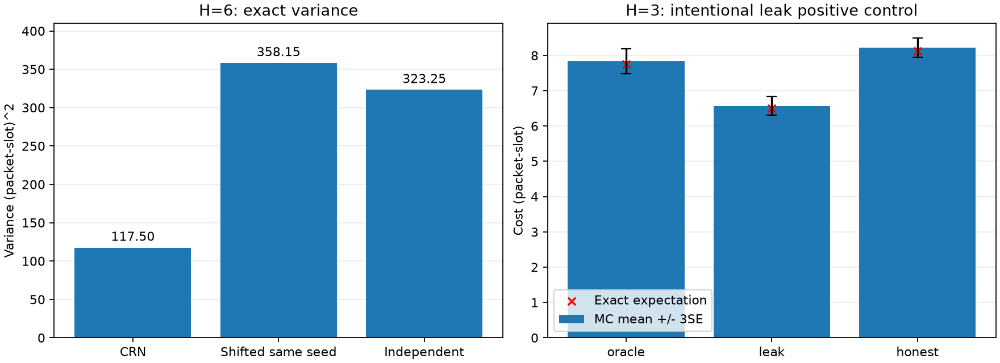

# L1.7 — CRN, stream, exposure và future leak

Người thực hiện: **Doan Van Tai** · 2026-10-22T17:21:46.384415+07:00.

Đây là lần chạy demo theo hai tài liệu được cung cấp, không là Phase4/E01 hoặc confirmation. Plant và oracle exact giữ nguyên. dt=1,cA=cB=3,u=2,bA=1,B on/off5/0,p=s=1/2,c_sw=0; mode slot0 biết trước, tie→Stay. Cost/Δ/SE tính bằng packet·slot; phương sai bằng (packet·slot)².

Root demo **144558766427411771296652109119745142241** được tiếp nhận từ tài liệu, không sinh mới. N=2000,episodes0–1999. NumPy2.5.3 được pin riêng; PCG64/SeedSequence. Không sinh/mở root discovery,calibration,confirmation.

## CRN so với cùng seed nhưng dịch một lần rút

x=(2,2,off),H6,extra1; hai cách có đúng cùng nhánh Stay. Primitive sinh B trước, extra draws từ branch; naive Switch dịch stream future. Độc lập chỉ tính exact, không chạy MC.

| Cách | MC mean Δ ± SE | Sample variance | Exact variance | Future khác /N | Residual khác0 /N |
|---|---:|---:|---:|---:|---:|
| primitive | 9.236000 ± 0.243796 | 118.872740 | 117.496094 | 0/2000 | 0/2000 |
| naive | 8.745000 ± 0.420489 | 353.621786 | 358.152344 | 1942/2000 | 1914/2000 |
| Independent (exact only) | — | — | 323.248047 | — | — |

Δ exact=145/16=9.0625. Hai marginal mean/variance naive khớp exact với CRN, nên unbiasedness ở cấu hình này được xác nhận bằng enumeration; mẫu MC trong ±3SE chỉ là consistency check. Cách ngây thơ ở đây tệ hơn independent, không suy thành quy luật mọi cấu hình.

Naive exact covariance=-17871/1024,correlation=-0.149655; conditional first keep/flip correlations=0.913346/-0.890419.

| State | H | Paired var | Independent var | Independent/paired | Correlation |
|---|---:|---:|---:|---:|---:|
| (2, 2, 'on') | 2 | 0.000000 | 12.500000 | ∞ | 1.000000 |
| (2, 2, 'off') | 2 | 2.250000 | 7.250000 | 3.222 | 1.000000 |
| (2, 2, 'off') | 6 | 117.496094 | 323.248047 | 2.751 | 0.882176 |
| (2, 2, 'on') | 6 | 52.308594 | 513.558594 | 9.818 | 0.954564 |
| (6, 6, 'on') | 6 | 7.058594 | 630.496094 | 89.323 | 0.992871 |
| (10, 10, 'on') | 6 | 0.272461 | 680.741211 | 2498.491 | 0.999649 |

Ghép canonical episodes cho GS: paired variance=99/64, independent=1359/64. Sai law p=s3/4 ở XB,H2 cho Δ−9/4 thay vì−3/2: CRN không sửa bias.

## Positive control cho rò tương lai

x=(2,2,off),H3,K1; oracle chọn bằng J exact. Honest lấy samples predictor độc lập với future evaluator; leak cố ý lấy đúng future để kiểm máy dò.

| Policy | MC cost ± SE | Exact cost |
|---|---:|---:|
| oracle | 7.836000 ± 0.116965 | 31/4 |
| leak | 6.572500 ± 0.089445 | 13/2 |
| honest | 8.220000 ± 0.089265 | 65/8 |

Honest thắng oracle trên **495/2000=24.75%** episode (exact25%). Đây là cost trên một realized future, ngay cả khi oracle J tính exact; không cần oracle estimation noise để có hiện tượng này. Leak không thua oracle ở bất kỳ episode đã kiểm. Paired oracle−leak=1.263500 ± 0.029060 SE. Canonical H2: **1200/1200** leak cost bằng oracle; có rò nhưng ví dụ chuẩn không thấy. Dấu hiệu này là positive control trong toy, không là test chứng nhận mọi leakage.

## Sampler bất đối xứng và giới hạn detector

H4,p3/4,s1/2,N2000 mỗi state. Runner lưu/in J để audit; do đó các outcome verification này cũng được ghi exposed.

| State | Action | Mean ± SE | Exact J | Error/SE |
|---|---|---:|---:|---:|
| (2, 2, 'on') | Stay | 28.060500 ± 0.182554 | 1803/64 | -0.610 |
| (2, 2, 'on') | Switch | 39.375000 ± 0.212019 | 2527/64 | -0.516 |
| (2, 0, 'off') | Stay | 13.998000 ± 0.097492 | 445/32 | 0.941 |
| (2, 0, 'off') | Switch | 13.359000 ± 0.190099 | 421/32 | 1.067 |

Residual0 là điều kiện cần của cùng background, không đủ. Phản ví dụ H4: Stay background[0,5,0,0],Switch[0,0,5,5],hai mảng khác nhau nhưng residual0 vì weighted arrivals triệt tiêu. Demo kiểm cả equality arrays và idle identity. Tape tự đặt cho costs19/41,residual15; đây không phải RNG sample.

## Test và mutation

- lesson: **13/13 PASS**,log `lesson.txt`,JUnit `lesson.xml`.
- lessons: **72/72 PASS**,log `lessons.txt`,JUnit `lessons.xml`.
- limits: **4/4 PASS**,log `limits.txt`,JUnit `limits.xml`.
- full_suite: **97/97 PASS**,log `full_suite.txt`,JUnit `full_suite.xml`.

72 là13 L1.7 +59 lesson trước; repo có thêm21 kiểm trước và4 kiểm L1.7 mới →97. Preflight17 đã PASS trước runner. Lần gọi preflight đầu bị shell từ chối vì thư mục output chưa tồn tại; chưa chạy pytest lúc đó. Đã tạo thư mục và giữ log lần chạy thật; không có lỗi baseline pytest.

| Mutant | Nội dung | Cases đỏ /13 | Functions đỏ |
|---|---|---:|---:|
| R1 | Action Switch mã hoá thành1 lọt vào khóa future | 5 | 3 |
| R2 | Switch rút extra_draws từ future thay vì branch | 4 | 3 |
| R3 | Đảo u<P(keep) thành u>=P(keep) | 2 | 2 |
| R4 | predictor_rng trả stream future B | 1 | 1 |
| R5 | Bỏ episode khỏi khóa của mọi role | 5 | 5 |
| R6 | Background luôn bắt đầu từ off | 2 | 2 |
| R7 | Bỏ chia K; equivalent mutant đối với action | 0 | 0 |

R1: `test_primitive_gives_identical_futures_whatever_the_branch_draws[0]`, `test_primitive_gives_identical_futures_whatever_the_branch_draws[1]`, `test_primitive_gives_identical_futures_whatever_the_branch_draws[7]`, `test_identity2_detector_zero_under_crn_nonzero_under_naive`, `test_naive_is_unbiased_but_noisier`

R2: `test_primitive_gives_identical_futures_whatever_the_branch_draws[1]`, `test_primitive_gives_identical_futures_whatever_the_branch_draws[7]`, `test_identity2_detector_zero_under_crn_nonzero_under_naive`, `test_naive_is_unbiased_but_noisier`

R3: `test_tape_example_from_part1`, `test_sampler_matches_exact_J_on_asymmetric_chain`

R4: `test_leaky_mk_beats_the_oracle_honest_mk_does_not`

R5: `test_naive_differs_only_because_of_the_extra_draw`, `test_episode_replay_and_order_independence`, `test_naive_is_unbiased_but_noisier`, `test_sampler_matches_exact_J_on_asymmetric_chain`, `test_leaky_mk_beats_the_oracle_honest_mk_does_not`

R6: `test_sampler_matches_exact_J_on_asymmetric_chain`, `test_canonical_example_is_blind_to_the_leak`

R7: Không bị bắt: equivalent đối với dấu/action hiện tại.

R1–R6 là intentional failures của mutant; R7 bỏ chiaK không đổi dấu nên phải qua. Tách số test functions khỏi parametrized cases; không ép số đỏ bằng tài liệu. Các patch chỉ áp trong subprocess, source baseline không bị sửa/copy. Role alias đơn thuần cũng chưa chắc tạo leak vì khóa(1,i) khác(1,i,B).



## Artifact và tái lập

Source: `experiments/lessons/l1_7_streams.py`,`l1_7_reference.py`,`run_l1_7.py`; tests: `tests/test_l1_7_streams.py`,`test_l1_7_limits.py`; pin `experiments/lessons/requirements-l1_7.txt`.

```bash
.venv/bin/python -m experiments.lessons.run_l1_7
.venv/bin/python -m experiments.lessons.run_l1_7 --output-dir /tmp/l1_7-rerun
```

| File | Nội dung |
|---|---|
| [config.json](config.json),[results.json](results.json) | Parameters,seeds,environment,commands,input/source hashes,metrics |
| [crn_episodes.csv](crn_episodes.csv),[crn_summary.csv](crn_summary.csv) | 4000 rows CRN/naive,chi tiết cost,idle,residual |
| [exact_moments.csv](exact_moments.csv),[exact_paths.csv](exact_paths.csv),[shifted_exact_paths.csv](shifted_exact_paths.csv) | Exact moments và 64 shifted sequences |
| [leak_episodes.csv](leak_episodes.csv),[leak_summary.csv](leak_summary.csv),[leak_exact_paths.csv](leak_exact_paths.csv) | Actions/evaluator futures/costs và exact leak reference |
| [canonical_blind_spot.csv](canonical_blind_spot.csv),[episode_pairing.csv](episode_pairing.csv) | H2 blind spot và GS episode pairing |
| [sampler_episodes.csv](sampler_episodes.csv),[sampler_checks.csv](sampler_checks.csv) | Asymmetric-chain samples và checks |
| [diagnostics.json](diagnostics.json),[artifact_checks.json](artifact_checks.json),[artifact_manifest.json](artifact_manifest.json) | Tape,counterexample,cross-file verification,SHA256 |
| run_output.txt,preflight.txt,lesson.txt,lessons.txt,limits.txt,full_suite.txt,*.xml | Actual baseline commands/log/JUnit |
| R1…R7.txt,*.xml,R*_patch.py | Intentional mutations và test phát hiện |
| [crn_and_leak.png](crn_and_leak.png) | Chart từ số liệu,không có network throughput/delay measurements |

Sổ seed/exposure/card đã ghi trước chạy. Hai trục stage×role chỉ là draft cho demo; chưa khóa contract-v1/thẻ8 L1.8. Predictor dùng(2,i) với sequential prefix samples, chưa có(2,i,k). Interface Python là quy ước, chưa là access-control sandbox. Không claim mọi sample đều independent hoặc chứng minh PRNG bằng tests.

Mock reviewer là bản tham khảo có tài liệu; không gán là bài kín sách của tác giả hoặc independent review. L0.5,Phụ lụcD,V3/V10/V11 còn mở. Không thay contract-v0,không fit H0/H1,không có held-out/network validation. G1 và HOLD Phase4 giữ nguyên.

Python 3.14.5;NumPy 2.5.3;pytest 9.1.1;wall time 42.277s (không là network benchmark).
