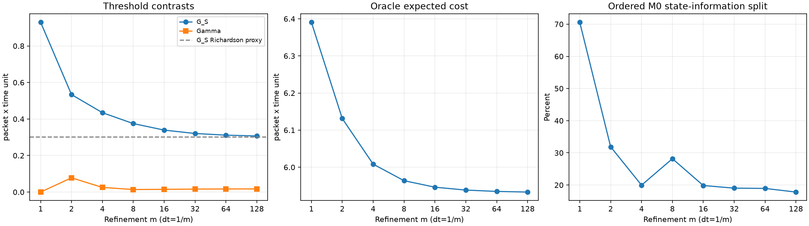

# L1.8 Part B — kiểm làm mịn trên calibration toy

Người thực hiện: **Doan Van Tai** · 2026-10-22T20:06:52.809913+07:00.

Giữ thế giới: capacity3/3,rateA1,managed2,Bon/off5/0 packet mỗi đơn vị thời gian; horizon2,observation(2,0) tại−1,stationary initial mode1/2 độc lập observation. Coarse p=s5/8,lambda1/4. R2,dt1/m,H2m,tau m;backlog không co giãn. Cost/gain: packet×đơn vị thời gian chuẩn của toy,không là calibration link thực.

Finite-law expectation bằng DP gộp state;backlog units1/m packet giữ nguyên grid integer. Không Monte Carlo/RNG/seed. Floating probabilities từ m4 trở đi,không claim arithmetic exact.

## Kết quả từng level

| m | H | States D | Lstar | GS | GM | GSM | Gamma | Freshness M0 | Mode M0 | Mode share |
|---:|---:|---:|---:|---:|---:|---:|---:|---:|---:|---:|
| 1 | 2 | 4 | 6.390625000 | 0.929687500 | 0.000000000 | 0.929687500 | 0.000000000 | 0.273437500 | 0.656250000 | 70.588% |
| 2 | 4 | 6 | 6.131225586 | 0.533813477 | 0.000000000 | 0.611816406 | 0.078002930 | 0.363647461 | 0.170166016 | 31.877% |
| 4 | 8 | 14 | 6.008341279 | 0.434653798 | 0.000000000 | 0.460112881 | 0.025459083 | 0.347921616 | 0.086732182 | 19.954% |
| 8 | 16 | 30 | 5.963776317 | 0.375064711 | 0.000000000 | 0.388841614 | 0.013776903 | 0.269372977 | 0.105691735 | 28.180% |
| 16 | 32 | 62 | 5.946226852 | 0.339263182 | 0.000000000 | 0.354167975 | 0.014904793 | 0.271941902 | 0.067321280 | 19.843% |
| 32 | 64 | 126 | 5.938468844 | 0.320785710 | 0.000000000 | 0.337051601 | 0.016265891 | 0.259730959 | 0.061054750 | 19.033% |
| 64 | 128 | 254 | 5.934848382 | 0.311603614 | 0.000000000 | 0.328544133 | 0.016940520 | 0.252580853 | 0.059022761 | 18.942% |
| 128 | 256 | 510 | 5.933106738 | 0.307151637 | 0.000000000 | 0.324303350 | 0.017151712 | 0.252443734 | 0.054707903 | 17.811% |

Đủ sáu contrasts,regrets vàM1-specific split tronglevel_metrics.csv. S0M0 vàS0M1 đều chọnSwitch ở mọi level→GM0. R110,meanI≈0,mass≈1,belief=D; zero-action controls cho contrasts0 tại mọi level. All states kiểm Jensen/F5 với rounding tolerance1e-10.

**Khác biệt nguồn:** Gamma tại m4=0.0254590834198094 làm tròn thành 0.025, nguồn ghi 0.026. Lstar tại m32=5.938468844428325 làm tròn thành 5.938, nguồn ghi 5.939. DP khớp finite-path reference m1/2/4 và forward scoring độc lập mọi level. Lưu 40 comparisons cùng mọi discrepancy, không nới tolerance để che khác biệt.

## Tolerance demo,rule vàRichardson

Cref tạm=Lstar(m128)=**5.933106737746**,tolerance1%=**0.059331067377**. Functional choice vàlevels đã ghi trongcard trước run;đáp án nguồn đã exposed. Cref dùng chung toàn bảng,chưa là reference cost/SESOI chính thức củaPartD.

| Rule | Pair kiểm | Report m | Có level thứ ba? | Max contrast error proxy / Cref |
|---|---|---:|---|---:|
| original_report_coarse | 8→16 | 8 | True | 1.219682% |
| proposed_report_fine | 8→16 | 16 | True | 0.616263% |
| proposed_half_tol_report_coarse | 16→32 | 16 | True | 0.616263% |

PASS của pair chỉ nói change≤tol và không signflip lớn;chưa chứng nhận continuum error. Cả3 rule được so cùng denominator. Có ít nhất3 levels để reportorder;chưa khóa hard band quanhrho1/2 nên không tự ghiorder certified hoặcGO cho physical anchors.

| m→2m→4m | rho GS | rho Gamma | Richardson GS từ2m/4m |
|---|---:|---:|---:|
| 1→2→4 | 0.250483 | -0.673614 | 0.335494119 |
| 2→4→8 | 0.600941 | 0.222332 | 0.315475625 |
| 4→8→16 | 0.600807 | -0.096548 | 0.303461653 |
| 8→16→32 | 0.516108 | 1.206765 | 0.302308238 |
| 16→32→64 | 0.496935 | 0.495650 | 0.302421517 |
| 32→64→128 | 0.484854 | 0.313050 | 0.302699661 |

Richardson từm64/128:GS≈**0.302699661**,Gamma≈**0.017362905**,Lstar≈**5.931365094**. Đây là conditional first-order estimates,không phải true fluid solution hoặcerror bound. Từm1/2,Richardson GS=0.137939453,sai xa estimate cuối;kết quả sớm chưa ởasymptotic regime. FlatGM0 ghi undefined/constant cho rho,không chia0 hoặcgánorder1.

Với M0 giữ cố định, mode share từ 70.588% xuống **17.811%** ở m128. Không đồng nhất ratio ngoại suy của hai components với limit đã chứng minh. Current-backlog cell conditionD làdiagnostic,không feasible telemetry/net gain. Câu hai phần baGS củaL1.6 chỉ thuộc chuỗi dạy họclambda0,không áp dụng mạng.

**Vấn đề phương pháp ở bảng B6:** Các giá trị freshness/mode của nguồn tái lập khi freshness=L00−L_current_M1 và mode=L_current_M1−L10. Điểm giữa dùng M1, điểm cuối S1M0 nên đã đổi model; tổng vẫn bằng GS nhưng không là hai bước state-only dưới cùng M0. Code giữ primary split M0 đã khai báo, lưu M1 split riêng và đường hybrid chỉ để audit nguồn. Không tự coi đây là định nghĩa của script gốc vì script đó chưa được cung cấp. Bảng source_split_comparison.csv cho thấy toàn bộ 10 giá trị làm tròn của nguồn khớp đường hybrid.

Hybrid mode share ở m128=11.611%; Richardson các components hybrid cho khoảng11% như nguồn, nhưng không gán nó cho fixed-model State repair. Hai components fixed-M0 chưa có rho gần1/2 tại triplet cuối; order của chúng còn inconclusive trong tám levels đã khai báo. Không mở thêm levels chỉ để đạt.

## Kiểm chứng và độ chính xác

- lesson: **13/13 PASS**,log`lesson.txt`,JUnit`lesson.xml`.
- full_suite: **124/124 PASS**,log`full_suite.txt`,JUnit`full_suite.xml`.

Finite-path reference m1/2/4:48 state-action pairs; maxerror=1.78e-15. m1 Lstar409/64,GS119/128 exact binary; m2 Lstar6.1312255859375,GS.5338134765625,Gamma.0780029296875.

Forward reference tái sinh D và score bốn ô cùng hai current-backlog policies ở mọi level: max aggregate cost difference=3.55e-15. Forward và backward dùng hai hướng tính riêng, vẫn là computational cross-check, chưa scientific independent review.

Float64/longdouble:maxJdifference=1.69e-14,maxM0difference=1.1e-14; action mismatches=0,alerted nonzero gaps=0. Alert64*eps*H*maxcost chỉ để kiểm tra,không đổi tie rule. Không suy same actions hai precision thành proof mọifloating error đã hết.

Solver float64 tổng wall time0.046252s trên máy hiện tại; đó là đo thực cho optimized toy DP,không dùng phút/m128 của nguồn làm số đo repo. Runtime/memory proxy của toy không dự báo budget lưới thật PartC.

## Kết luận và phần chưa làm

Đã tái lập xu hướngGS giảm,Gamma khôngmonotonic,GM0 trên calibrationcell này. Một pair PASS chưa đủ kết luận sai số của coarse level dưới tolerance;Richardson early windows có thể sai đáng kể. Không chứng minh GS luôn giảm với dt trong mọi regime. Không ổn định trong budget cũng chưa chứng minh không có limit.

Bốn đề xuất §11 ghi thànhworking protocol,không sửa frozencontractv0. Cref/threshold,asymptoticcriterion,calibrationgrid chính thức vàdt mỗi neo còn chờPartsC–E. Chưa chạyPhase3 A01 tổngquát,packetDES/Phase7 hoặcnetworkmeasurement; chưa fitH0/H1 hoặcheldout. G1,V3/V10/V11,HOLDPhase4 giữ nguyên.

## File và tái chạy

```bash
.venv/bin/python -m experiments.lessons.run_l1_8_b
.venv/bin/python -m experiments.lessons.run_l1_8_b --output-dir /tmp/l1_8_b-rerun
```

| Artifact | Nội dung |
|---|---|
| [config.json](config.json),[results.json](results.json) | Cấu hình,threshold rule,commands,source/input hashes,metrics |
| [level_metrics.csv](level_metrics.csv),[state_cells.csv](state_cells.csv) | Đủ levels,costs/gaps/actions/probabilities/current cells |
| [pair_checks.csv](pair_checks.csv),[half_tolerance_checks.csv](half_tolerance_checks.csv),[rule_comparison.csv](rule_comparison.csv) | Rules dưới1%/.5% |
| [monitored_changes.csv](monitored_changes.csv),[triplet_diagnostics.csv](triplet_diagnostics.csv),[richardson_proxies.csv](richardson_proxies.csv) | Smooth/threshold/split diagnostics,mọi windows |
| [finite_path_reference.csv](finite_path_reference.csv),[zero_action_controls.csv](zero_action_controls.csv) | Reference/control checks |
| [forward_reference.csv](forward_reference.csv),[source_split_comparison.csv](source_split_comparison.csv) | Forward scoring độc lập và audit hybrid split |
| [near_ties.csv](near_ties.csv),[precision_comparison.csv](precision_comparison.csv) | Numeric alarms,precision stability |
| [source_comparison.csv](source_comparison.csv),[source_discrepancies.json](source_discrepancies.json) | Audit bảng nguồn |
| [refinement_and_mode_share.png](refinement_and_mode_share.png) | Plot từ số liệu |
| run_output.txt,lesson.txt,full_suite.txt,preflight.txt,*.xml | Actual logs vàJUnit |
| [artifact_checks.json](artifact_checks.json),[artifact_manifest.json](artifact_manifest.json) | CSV/hash checks |

Python3.14.5,NumPy2.5.3,longdouble eps1.0842021724855044e-19; runner walltime14.070s. Khôngseed/RNG/MC hoặcCI lấy mẫu.


